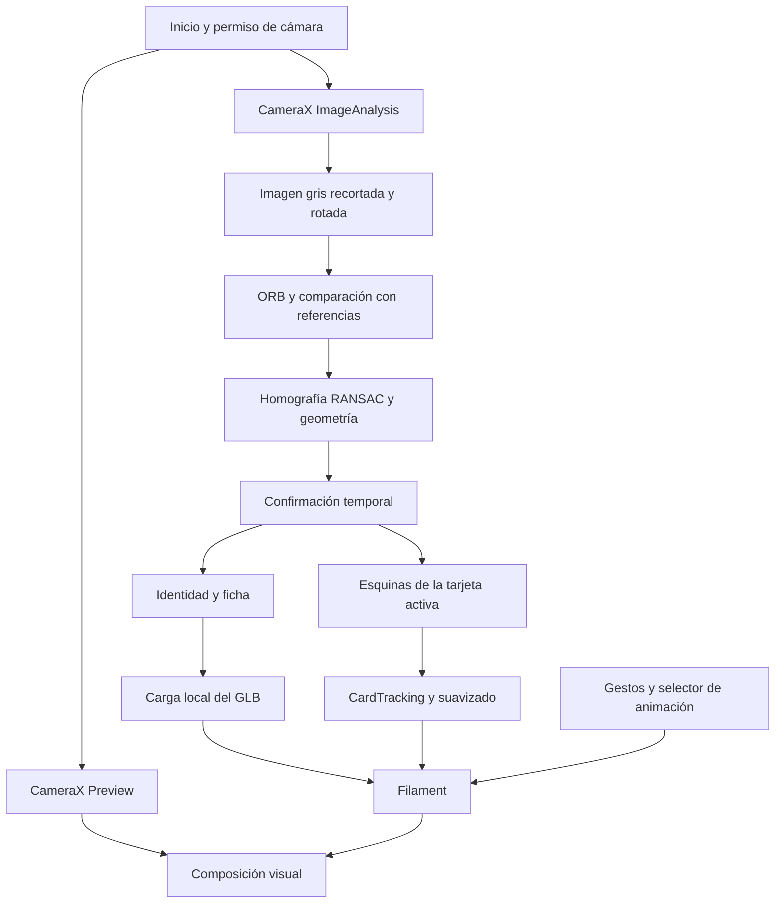

# DinoAR — Manual de integración del proyecto

**Versión documental:** 2.0  
**Fecha:** 20 de noviembre de 2026  
**Paquete de la aplicación:** `com.example.dinoar`

## Índice

1. [Propósito y alcance](#1-propósito-y-alcance)
2. [Requisitos del entorno](#2-requisitos-del-entorno)
3. [Configuración y dependencias](#3-configuración-y-dependencias)
4. [Estructura del proyecto](#4-estructura-del-proyecto)
5. [Flujo de integración](#5-flujo-de-integración)
6. [Pantallas, navegación y permisos](#6-pantallas-navegación-y-permisos)
7. [Integración de CameraX](#7-integración-de-camerax)
8. [Integración de OpenCV y tarjetas](#8-integración-de-opencv-y-tarjetas)
9. [Seguimiento visual y coordenadas](#9-seguimiento-visual-y-coordenadas)
10. [Integración del renderizador 3D](#10-integración-del-renderizador-3d)
11. [Animaciones y gestos](#11-animaciones-y-gestos)
12. [Agregar o sustituir dinosaurios](#12-agregar-o-sustituir-dinosaurios)
13. [Concurrencia y ciclo de vida](#13-concurrencia-y-ciclo-de-vida)
14. [Compilación, instalación y APK](#14-compilación-instalación-y-apk)
15. [Verificación y pruebas](#15-verificación-y-pruebas)
16. [Diagnóstico de errores](#16-diagnóstico-de-errores)
17. [Mantenimiento y recursos](#17-mantenimiento-y-recursos)
18. [Ruta práctica de recreación](#18-ruta-práctica-de-recreación)

## 1. Propósito y alcance

Este documento explica cómo preparar, integrar, compilar y mantener DinoAR a
partir de su código existente. Las rutas indicadas son relativas a la raíz del
proyecto, salvo que se especifique otra cosa.

DinoAR combina una vista previa de cámara con reconocimiento local de tarjetas
y renderizado de modelos GLB. Cada identificación selecciona un dinosaurio, su
ficha informativa y sus animaciones disponibles.

El seguimiento actual relaciona la posición, el tamaño aparente y el giro en el
plano de la tarjeta con el objeto virtual. No estima una pose espacial completa:
no hay calibración de cámara ni ejecución de `solvePnP`. Esta distinción debe
conservarse al ampliar el proyecto.

La aplicación utiliza Kotlin, XML, ViewBinding, Material Components, CameraX,
OpenCV y Filament. El procesamiento y los recursos son locales. El manifiesto
principal no solicita acceso a Internet y no integra ARCore, Unity o Vuforia.


### Cómo utilizar los bloques de código

Los bloques identificados como **archivo completo** se extrajeron del proyecto
actual: incluyen `package`, imports y la implementación real. Crea cada archivo
con la ruta indicada y copia su bloque completo. Si el archivo ya existe,
reemplaza su contenido en lugar de añadir una segunda clase o duplicar funciones.
Los fragmentos breves de configuración y comandos se identifican por su contexto.

Las clases se explican por responsabilidad, pero se referencian entre sí. Sigue
[la ruta práctica de recreación](#18-ruta-práctica-de-recreación) para conocer el
orden de trabajo y no intentes ejecutar una etapa con sus dependencias aún ausentes.
La implementación completa de `CameraActivity` aparece en la sección 11 porque
reúne permisos, carga, seguimiento, gestos y controles; su ciclo de vida se explica
además en la sección 13.

El documento permite reconstruir la lógica, configuración e interfaz. Los GLB,
las imágenes de referencia y el Gradle Wrapper contienen recursos binarios:
**no se reconstruyen copiando texto Markdown**. Deben obtenerse del proyecto o
prepararse siguiendo las instrucciones de recursos. Las rutas y los nombres
registrados en el catálogo deben corresponder exactamente a esos archivos.

Los bloques reflejan la versión del código al actualizar este manual. Si cambias
una clase posteriormente, revisa también su bloque para evitar divergencias.

## 2. Requisitos del entorno

### Desarrollo

- Android Studio con soporte para la configuración Gradle del proyecto.
- Android SDK Platform 37 y las herramientas de compilación requeridas por AGP.
- JDK 25 para satisfacer `gradle/gradle-daemon-jvm.properties`.
- Gradle Wrapper incluido en el repositorio; no es necesario instalar otra
  distribución global de Gradle.
- Conexión durante la primera sincronización para descargar herramientas y
  dependencias. Una caché completa permite compilar posteriormente con `--offline`.

La opción `JavaVersion.VERSION_17` del módulo define la compatibilidad del código
Java compilado; no sustituye el JDK con el que se ejecuta Gradle.

### Ejecución Android

- Android 8.0/API 26 o posterior.
- Cámara trasera disponible y permiso `CAMERA` concedido.
- OpenGL ES 3.0 o superior.
- ABI compatible con las bibliotecas nativas incluidas en el APK.

El enfoque automático es opcional en el manifiesto, aunque el enfoque y la
nitidez influyen en el reconocimiento. No se necesitan cuentas, claves de API,
servidores ni descargas de modelos durante el uso.

## 3. Configuración y dependencias

### Archivos de configuración

| Archivo | Responsabilidad |
| --- | --- |
| `settings.gradle.kts` | Módulo `:app`, repositorios Google/Maven Central y resolución de plugins |
| `build.gradle.kts` | Declaración del plugin Android en la raíz |
| `gradle/libs.versions.toml` | Versiones y alias de dependencias |
| `app/build.gradle.kts` | SDK, identidad, ViewBinding, dependencias y empaquetado |
| `gradle/wrapper/gradle-wrapper.properties` | Distribución Gradle y suma SHA-256 |
| `gradle/gradle-daemon-jvm.properties` | Criterio de selección del JDK del daemon |
| `gradle.properties` | Memoria de Gradle, límite de workers y opciones generales |
| `local.properties` | Ruta local del Android SDK; específica de cada equipo |

Las versiones fijadas actualmente son:

| Componente | Versión |
| --- | --- |
| Android Gradle Plugin | 9.3.3 |
| Gradle Wrapper | 9.5.0 |
| AndroidX Core KTX | 1.19.1 |
| AppCompat | 1.8.0 |
| Material Components | 1.13.0 |
| CameraX: core, camera2, lifecycle y view | 1.5.3 |
| OpenCV Android | 4.12.0 |
| Filament y gltfio | 1.69.5 |
| JUnit | 4.13.2 |
| AndroidX Test JUnit | 1.3.0 |
| Espresso Core | 3.7.0 |

Kotlin está integrado mediante AGP; el módulo no aplica un plugin Compose ni
un segundo plugin Kotlin Android. La compilación usa `compileSdk = 37`,
`targetSdk = 37` y `minSdk = 26`.

En `app/build.gradle.kts` deben conservarse:

```kotlin
buildFeatures { viewBinding = true }
androidResources { noCompress += "glb" }
```

Las versiones de todos los artefactos CameraX deben permanecer alineadas, al igual
que las de Filament y gltfio. Al actualizar una dependencia, revisar su
documentación y compatibilidad, sincronizar y ejecutar las verificaciones de la
sección 15. No cambiar a versiones dinámicas como `+`.

### Código: configuración reproducible

Los siguientes bloques pertenecen a esta sección. Sus rutas parten de la raíz del proyecto.

#### `settings.gradle.kts`

**Archivo completo:** [settings.gradle.kts](settings.gradle.kts)

Configura los repositorios y registra el módulo. Debe estar en la raíz, no dentro de `app/`.

```kotlin
pluginManagement {
    repositories {
        google {
            content {
                includeGroupByRegex("com\\.android.*")
                includeGroupByRegex("com\\.google.*")
                includeGroupByRegex("androidx.*")
            }
        }
        mavenCentral()
        gradlePluginPortal()
    }
}
plugins {
    id("org.gradle.toolchains.foojay-resolver-convention") version "1.0.0"
}
dependencyResolutionManagement {
    repositoriesMode.set(RepositoriesMode.FAIL_ON_PROJECT_REPOS)
    repositories {
        google()
        mavenCentral()
    }
}

rootProject.name = "DinoAR"
include(":app")
 
```

#### `libs.versions.toml`

**Archivo completo:** [gradle/libs.versions.toml](gradle/libs.versions.toml)

Crea primero el catálogo: los alias `libs` de los archivos Gradle se generan a partir de estas entradas.

```toml
[versions]
agp = "9.3.3"
coreKtx = "1.19.1"
appcompat = "1.8.0"
material = "1.13.0"
camera = "1.5.3"
opencv = "4.12.0"
filament = "1.69.5"
junit = "4.13.2"
junitVersion = "1.3.0"
espressoCore = "3.7.0"

[libraries]
androidx-core-ktx = { module = "androidx.core:core-ktx", version.ref = "coreKtx" }
androidx-appcompat = { module = "androidx.appcompat:appcompat", version.ref = "appcompat" }
material = { module = "com.google.android.material:material", version.ref = "material" }
camera-core = { module = "androidx.camera:camera-core", version.ref = "camera" }
camera-camera2 = { module = "androidx.camera:camera-camera2", version.ref = "camera" }
camera-lifecycle = { module = "androidx.camera:camera-lifecycle", version.ref = "camera" }
camera-view = { module = "androidx.camera:camera-view", version.ref = "camera" }
opencv = { module = "org.opencv:opencv", version.ref = "opencv" }
filament-core = { module = "com.google.android.filament:filament-android", version.ref = "filament" }
filament-gltfio = { module = "com.google.android.filament:gltfio-android", version.ref = "filament" }
junit = { module = "junit:junit", version.ref = "junit" }
androidx-junit = { module = "androidx.test.ext:junit", version.ref = "junitVersion" }
androidx-espresso-core = { module = "androidx.test.espresso:espresso-core", version.ref = "espressoCore" }

[plugins]
android-application = { id = "com.android.application", version.ref = "agp" }
```

#### `build.gradle.kts`

**Archivo completo:** [build.gradle.kts](build.gradle.kts)

Declara el plugin en la raíz sin aplicarlo como módulo de aplicación.

```kotlin
plugins { alias(libs.plugins.android.application) apply false }
```

#### `build.gradle.kts`

**Archivo completo:** [app/build.gradle.kts](app/build.gradle.kts)

Aplica el plugin al módulo y activa ViewBinding. Reúne todas las dependencias utilizadas por el código del manual.

```kotlin
plugins { alias(libs.plugins.android.application) }

android {
    namespace = "com.example.dinoar"
    compileSdk { version = release(37) }
    defaultConfig {
        applicationId = "com.example.dinoar"
        minSdk = 26
        targetSdk = 37
        versionCode = 1
        versionName = "1.0"
        testInstrumentationRunner = "androidx.test.runner.AndroidJUnitRunner"
    }
    compileOptions {
        sourceCompatibility = JavaVersion.VERSION_17
        targetCompatibility = JavaVersion.VERSION_17
    }
    buildFeatures { viewBinding = true }
    androidResources { noCompress += "glb" }
}

dependencies {
    implementation(libs.androidx.core.ktx)
    implementation(libs.androidx.appcompat)
    implementation(libs.material)
    implementation(libs.camera.core)
    implementation(libs.camera.camera2)
    implementation(libs.camera.lifecycle)
    implementation(libs.camera.view)
    implementation(libs.opencv)
    implementation(libs.filament.core)
    implementation(libs.filament.gltfio)
    testImplementation(libs.junit)
    androidTestImplementation(libs.androidx.junit)
    androidTestImplementation(libs.androidx.espresso.core)
}
```

#### `gradle.properties`

**Archivo completo:** [gradle.properties](gradle.properties)

Conserva las opciones de Gradle del proyecto. El límite de workers pertenece a la compilación, no al procesamiento de cámara.

```properties
# Project-wide Gradle settings.
# IDE (e.g. Android Studio) users:
# Gradle settings configured through the IDE *will override*
# any settings specified in this file.
# For more details on how to configure your build environment visit
# http://www.gradle.org/docs/current/userguide/build_environment.html
# Specifies the JVM arguments used for the daemon process.
# The setting is particularly useful for tweaking memory settings.
org.gradle.jvmargs=-Xmx2048m -Dfile.encoding=UTF-8
org.gradle.workers.max=2
# When configured, Gradle will run in incubating parallel mode.
# This option should only be used with decoupled projects. For more details, visit
# https://developer.android.com/r/tools/gradle-multi-project-decoupled-projects
# org.gradle.parallel=true
# When enabled, the Configuration Cache allows Gradle to skip the configuration
# phase entirely if nothing that affects the build configuration (such as build scripts)
# has changed. Additionally, Gradle applies performance optimizations to task execution.
org.gradle.configuration-cache=true
# Kotlin code style for this project: "official" or "obsolete":
kotlin.code.style=official
```

#### `gradle-wrapper.properties`

**Archivo completo:** [gradle/wrapper/gradle-wrapper.properties](gradle/wrapper/gradle-wrapper.properties)

Fija la distribución y su suma de verificación. También hacen falta los scripts y el JAR del Wrapper; este archivo por sí solo no los genera.

```properties
#Mon Nov 16 13:21:35 GMT-04:00 2026
distributionBase=GRADLE_USER_HOME
distributionPath=wrapper/dists
distributionSha256Sum=553c78f50dafcd54d65b9a444649057857469edf836431389695608536d6b746
distributionUrl=https\://services.gradle.org/distributions/gradle-9.5.0-bin.zip
networkTimeout=10000
validateDistributionUrl=true
zipStoreBase=GRADLE_USER_HOME
zipStorePath=wrapper/dists
```

#### `gradle-daemon-jvm.properties`

**Archivo completo:** [gradle/gradle-daemon-jvm.properties](gradle/gradle-daemon-jvm.properties)

Conserva el criterio del JDK y las ubicaciones generadas por Gradle para resolverlo. No confundirlo con la compatibilidad Java del módulo.

```properties
#This file is generated by updateDaemonJvm
toolchainUrl.FREE_BSD.AARCH64=https\://api.foojay.io/disco/v3.0/ids/cf726b4a1c84b50457225f9bba6d7650/redirect
toolchainUrl.FREE_BSD.X86_64=https\://api.foojay.io/disco/v3.0/ids/fa1e318c287360478e3c83a9a3ef1007/redirect
toolchainUrl.LINUX.AARCH64=https\://api.foojay.io/disco/v3.0/ids/cf726b4a1c84b50457225f9bba6d7650/redirect
toolchainUrl.LINUX.X86_64=https\://api.foojay.io/disco/v3.0/ids/fa1e318c287360478e3c83a9a3ef1007/redirect
toolchainUrl.MAC_OS.AARCH64=https\://api.foojay.io/disco/v3.0/ids/c2dd35c9d0aaf0ba6ad0791320f99dfc/redirect
toolchainUrl.MAC_OS.X86_64=https\://api.foojay.io/disco/v3.0/ids/e5810bd7fd1f8a586644409d395a7e55/redirect
toolchainUrl.UNIX.AARCH64=https\://api.foojay.io/disco/v3.0/ids/cf726b4a1c84b50457225f9bba6d7650/redirect
toolchainUrl.UNIX.X86_64=https\://api.foojay.io/disco/v3.0/ids/fa1e318c287360478e3c83a9a3ef1007/redirect
toolchainUrl.WINDOWS.AARCH64=https\://api.foojay.io/disco/v3.0/ids/7b3c4877c0749019e6805bb61e421497/redirect
toolchainUrl.WINDOWS.X86_64=https\://api.foojay.io/disco/v3.0/ids/d76df094a9cbbabd3b08251f9e61444a/redirect
toolchainVersion=25
```


## 4. Estructura del proyecto

```text
DinoAR/
├── app/
│   └── src/
│       ├── main/
│       │   ├── AndroidManifest.xml
│       │   ├── java/com/example/dinoar/
│       │   │   ├── MainActivity.kt
│       │   │   ├── camera/
│       │   │   ├── detection/
│       │   │   ├── rendering/
│       │   │   ├── model/
│       │   │   ├── ui/
│       │   │   └── utils/
│       │   ├── assets/markers/
│       │   ├── assets/models/
│       │   └── res/
│       ├── debug/          # Host de pruebas gráficas
│       ├── test/           # Pruebas JVM
│       └── androidTest/    # Pruebas instrumentadas
├── gradle/
├── printable/tarjetas.html
├── tools/build-debug.ps1
├── docs/
├── THIRD_PARTY.md
└── MANUAL_INTEGRACION.md
```

### Responsabilidades del código

| Clase o archivo | Función |
| --- | --- |
| `MainActivity` | Inicio, instrucciones y entrada a la exploración |
| `CameraActivity` | Permisos, coordinación de componentes, controles y navegación |
| `CameraManager` | Creación y vinculación de Preview e ImageAnalysis |
| `FrameAnalyzer` | Conversión, frecuencia de análisis y publicación de resultados |
| `MarkerDatabase` | Carga de referencias y precálculo de descriptores |
| `MarkerDetector` | ORB, correspondencias, homografía y selección de tarjeta |
| `QuadGeometry` | Validación geométrica de las esquinas proyectadas |
| `RecognitionStabilizer` | Confirmación temporal y tolerancia a pérdidas |
| `DetectionConfig` | Parámetros del reconocimiento |
| `DetectionResult` | Identidad, esquinas, dimensiones y estadísticas del frame |
| `CardTracking` | Conversión a posición, ancho aparente y giro en pantalla |
| `ModelManager` | Lectura asíncrona de GLB y descarte de cargas obsoletas |
| `DinosaurRenderer` | Motor Filament, escena, transformaciones y animaciones |
| `Dinosaur` / `DinosaurRepository` | Catálogo, rutas y contenido educativo |
| `DinosaurInfoActivity` | Presentación de la ficha seleccionada |
| `LumaPlane` / `ImageUtils` | Lectura del plano Y, recorte, rotación y reducción |
| `WindowInsets` | Ajuste de controles a barras del sistema y recortes de pantalla |

### Código: entidades y catálogo compartido

Los siguientes bloques pertenecen a esta sección. Sus rutas parten de la raíz del proyecto.

#### `Dinosaur.kt`

**Archivo completo:** [app/src/main/java/com/example/dinoar/model/Dinosaur.kt](app/src/main/java/com/example/dinoar/model/Dinosaur.kt)

Define los identificadores y los datos que comparten detector, fichas y renderizador. Los valores de presentación y encuadre evitan condiciones especiales en las actividades.

```kotlin
package com.example.dinoar.model

enum class DinosaurId {
    TREX, TRICERATOPS, VELOCIRAPTOR, PACHYCEPHALOSAURUS,
    MOSASAURUS, DIMORPHODON, SPINOSAURUS, ANKYLOSAURUS
}

data class ModelPresentation(val yawDegrees: Float = -25f, val pitchDegrees: Float = 0f,
                             val scaleMultiplier: Float = 1f)

/** Bind-pose bounds when an exporter supplies mesh bounds before skin deformation. */
data class ModelFraming(val centerX: Float, val centerY: Float, val centerZ: Float,
                        val halfX: Float, val halfY: Float, val halfZ: Float)

data class Dinosaur(
    val id: DinosaurId,
    val name: String,
    val period: String,
    val diet: String,
    val length: String,
    val description: String,
    val markerPath: String,
    val modelPath: String,
    val framing: ModelFraming? = null,
    val scientificName: String = name,
    val group: String = "Dinosaurio",
    val features: String = description,
    val sourceUrl: String = "",
    val modelCredit: String = "",
    val expectedAnimations: Int? = null,
    val presentation: ModelPresentation = ModelPresentation(),
    val fallbackModelPath: String = "models/demo_cube.glb"
)
```

#### `DinosaurRepository.kt`

**Archivo completo:** [app/src/main/java/com/example/dinoar/model/DinosaurRepository.kt](app/src/main/java/com/example/dinoar/model/DinosaurRepository.kt)

Este es el catálogo real de ocho registros. Para una recreación fiel, copia las referencias y modelos indicados; para otros recursos, actualiza también sus rutas, encuadre, créditos y número esperado de pistas.

```kotlin
package com.example.dinoar.model

object DinosaurRepository {
    val dinosaurs = listOf(
        Dinosaur(DinosaurId.TREX, "Tiranosaurio Rex", "Cretácico tardío", "Carnívoro",
            "12–13 metros", "Gran dinosaurio terópodo conocido por sus poderosas mandíbulas y extremidades anteriores pequeñas.",
            "markers/trex_marker.jpg", "models/trex.glb", scientificName = "Tyrannosaurus rex", expectedAnimations = 5),
        Dinosaur(DinosaurId.TRICERATOPS, "Triceratops", "Cretácico tardío", "Herbívoro",
            "8–9 metros", "Dinosaurio caracterizado por sus tres cuernos y una gran estructura ósea alrededor del cuello.",
            "markers/triceratops_marker.jpg", "models/triceratops.glb", scientificName = "Triceratops sp.", expectedAnimations = 0, fallbackModelPath = "models/demo_pyramid.glb"),
        Dinosaur(DinosaurId.VELOCIRAPTOR, "Velociraptor", "Cretácico tardío", "Carnívoro",
            "Aproximadamente 2 metros", "Pequeño dinosaurio terópodo emplumado, ágil y bípedo, caracterizado por una gran garra curva en el segundo dedo de cada pie.",
            "markers/velociraptor_marker.jpg", "models/velociraptor.glb",
            // Bounds computed from original positions, joint weights and inverse bind matrices.
            ModelFraming(-0.029312f, 0.950084f, -0.446427f, 0.586652f, 0.959821f, 1.813569f), scientificName = "Velociraptor sp.", expectedAnimations = 26),
        Dinosaur(DinosaurId.PACHYCEPHALOSAURUS, "Pachycephalosaurus", "Cretácico tardío", "Principalmente herbívoro; dieta debatida",
            "Unos 3 metros", "Dinosaurio bípedo de América del Norte. Su cúpula craneal pudo tener funciones de exhibición o interacción entre individuos; su uso exacto sigue en estudio.", "markers/pachycephalosaurus_marker.png", "models/pachycephalosaurus.glb",
            ModelFraming(-0.28342486f, 1.05804239f, -0.32504889f, 0.78991056f, 1.05863773f, 1.70281415f),
            scientificName = "Pachycephalosaurus sp.", group = "Dinosaurio", features = "Cúpula ósea en el cráneo, protuberancias alrededor de la cabeza y postura bípeda.",
            sourceUrl = "https://www.nhm.ac.uk/discover/dino-directory/pachycephalosaurus.html", modelCredit = "PBR Pachycephalasaurus (Animated) — Ferocious Industries (https://sketchfab.com/ferociousindustries.matthias). CC-BY-4.0 (http://creativecommons.org/licenses/by/4.0/). https://sketchfab.com/3d-models/pbr-pachycephalasaurus-animated-6eea5cee4afa4730bf75c6329a43e56d. Render de tarjeta derivado del modelo; GLB sin modificar.", expectedAnimations = 21,
            presentation = ModelPresentation(-65f, 0f)),
        Dinosaur(DinosaurId.MOSASAURUS, "Mosasaurus", "Cretácico tardío", "Carnívoro",
            "8–12 metros según especie; estimaciones mayores debatidas", "Reptil marino que respiraba aire y cazaba en los mares del Cretácico. Sus extremidades se transformaron en aletas. No era un dinosaurio.", "markers/mosasaurus_marker.png", "models/mosasaurus.glb",
            ModelFraming(-0.00000002f, 0.00854163f, -0.14962452f, 0.07807941f, 0.04103131f, 0.25583256f),
            scientificName = "Mosasaurus sp.", group = "Reptil marino", features = "Cuerpo alargado, mandíbulas con dientes, aletas y cola propulsora.",
            sourceUrl = "https://www.nhm.ac.uk/discover/what-is-a-mosasaur.html", modelCredit = "Mosasaurus — Alexey Zaika (https://sketchfab.com/lexazaixa25). CC-BY-4.0 (http://creativecommons.org/licenses/by/4.0/). https://sketchfab.com/3d-models/mosasaurus-684754a2ad8c46aca0634326b53d1f04. Render de tarjeta derivado del modelo; GLB sin modificar.", expectedAnimations = 1,
            presentation = ModelPresentation(-65f, 10f)),
        Dinosaur(DinosaurId.DIMORPHODON, "Dimorphodon", "Jurásico temprano", "Carnívoro: pequeños vertebrados",
            "Unos 1 metro de longitud; hasta 2 metros de envergadura", "Pterosaurio del Jurásico temprano con dos tipos de dientes. Sus alas eran membranas sostenidas por un dedo alargado. No era un dinosaurio.", "markers/dimorphodon_marker.png", "models/dimorphodon.glb",
            ModelFraming(0.00181398f, 0.18502732f, -5.75940566f, 12.94278987f, 1.40765403f, 10.90749690f),
            scientificName = "Dimorphodon sp.", group = "Pterosaurio", features = "Cabeza grande, dentición diferenciada, alas membranosas y cola larga.",
            sourceUrl = "https://www.nhm.ac.uk/discover/mary-anning-fossils.html", modelCredit = "Modelo proporcionado por el usuario; autor y licencia no incluidos en el GLB. Tarjeta renderizada desde su malla.", expectedAnimations = 1,
            presentation = ModelPresentation(-10f, 35f)),
        Dinosaur(DinosaurId.SPINOSAURUS, "Spinosaurus", "Cretácico tardío", "Carnívoro, con consumo de peces",
            "Aproximadamente 14 metros", "Gran terópodo del norte de África. Su hocico y dientes ayudaban a capturar peces. Se investiga cuánto tiempo pasaba nadando o junto a las orillas.", "markers/spinosaurus_marker.png", "models/spinosaurus.glb",
            ModelFraming(0.00007394f, 0.92793309f, -0.29357999f, 0.40718778f, 0.93393171f, 2.15100752f),
            scientificName = "Spinosaurus sp.", group = "Dinosaurio", features = "Hocico largo, dientes cónicos y altas espinas dorsales que sostenían una vela.",
            sourceUrl = "https://www.nhm.ac.uk/discover/dino-directory/spinosaurus.html", modelCredit = "Modelo proporcionado por el usuario; autor y licencia no incluidos en el GLB. Tarjeta renderizada desde su malla.", expectedAnimations = 1,
            presentation = ModelPresentation(-65f, 0f)),
        Dinosaur(DinosaurId.ANKYLOSAURUS, "Ankylosaurus", "Cretácico tardío", "Herbívoro",
            "Hasta unos 8 metros", "Dinosaurio cuadrúpedo acorazado de América del Norte. Su cuerpo estaba protegido por placas óseas y su cola terminaba en una maza.", "markers/ankylosaurus_marker.png", "models/ankylosaurus.glb",
            ModelFraming(0.00000015f, 4.27472347f, -3.12023994f, 4.56390511f, 4.33316694f, 12.24428931f),
            scientificName = "Ankylosaurus sp.", group = "Dinosaurio", features = "Armadura ósea, cuerpo bajo y ancho, y maza caudal.",
            sourceUrl = "https://www.nhm.ac.uk/discover/dino-directory/ankylosaurus.html", modelCredit = "Modelo proporcionado por el usuario; autor y licencia no incluidos en el GLB. Tarjeta renderizada desde su malla.", expectedAnimations = 1,
            presentation = ModelPresentation(-65f, 0f))
    )
    fun get(id: DinosaurId) = dinosaurs.first { it.id == id }
    fun fromName(id: String?) = dinosaurs.firstOrNull { it.id.name == id }
}
```


## 5. Flujo de integración



La identificación y la posición tienen frecuencias distintas. La identidad cambia
cuando se confirma otra tarjeta o se pierde la actual. Las esquinas se comunican
en cada detección válida de la tarjeta confirmada, permitiendo actualizar la
transformación sin recargar el modelo.

## 6. Pantallas, navegación y permisos

### Pantallas XML

- `activity_main.xml`: presentación, botón de inicio e instrucciones.
- `activity_camera.xml`: cámara, capa transparente 3D, estado y controles.
- `layout-land/activity_camera.xml`: distribución alternativa en horizontal.
- `activity_dinosaur_info.xml`: ficha educativa.
- `item_animation.xml`: fila del selector de animaciones.

Los textos están en `res/values/strings.xml`; los colores y estilos en
`colors.xml` y `themes.xml`. Los atributos exclusivos de API 27 se encuentran en
`values-v27/themes.xml`. Al cambiar controles de la cámara, actualizar ambas
orientaciones y conservar los identificadores utilizados por ViewBinding.

### Navegación

`MainActivity` abre `CameraActivity` mediante un Intent. El botón Información
transfiere `DinosaurId.name` usando `DinosaurInfoActivity.EXTRA_DINOSAUR`, cuyo
valor es `dinosaur_id`. La ficha recupera el elemento del repositorio; si el
identificador no es válido, termina la actividad.

Solo la actividad de inicio está exportada. Las actividades de cámara e
información son internas.

### Permiso de cámara

El manifiesto declara `android.permission.CAMERA`. `CameraActivity` lo comprueba
al iniciar y lo solicita con `ActivityResultContracts.RequestPermission`.
Cuando se deniega, muestra una explicación y acceso a los ajustes de la app.
Al regresar desde Ajustes se vuelve a comprobar el permiso.

La anotación de supresión en `CameraManager` no concede permisos: depende de la
comprobación realizada por `CameraActivity` antes de iniciar CameraX.

### Código: pantallas, recursos y navegación

Los siguientes bloques pertenecen a esta sección. Sus rutas parten de la raíz del proyecto.

#### `AndroidManifest.xml`

**Archivo completo:** [app/src/main/AndroidManifest.xml](app/src/main/AndroidManifest.xml)

Declara permiso, requisitos y actividades. Conserva los iconos de launcher de la plantilla Android Studio o copia los correspondientes de `res/`; el manifiesto los referencia.

```xml
<?xml version="1.0" encoding="utf-8"?>
<manifest xmlns:android="http://schemas.android.com/apk/res/android">
    <uses-permission android:name="android.permission.CAMERA" />
    <uses-feature android:name="android.hardware.camera.any" android:required="true" />
    <uses-feature android:name="android.hardware.camera.autofocus" android:required="false" />
    <uses-feature android:glEsVersion="0x00030000" android:required="true" />
    <application android:allowBackup="false" android:icon="@mipmap/ic_launcher"
        android:dataExtractionRules="@xml/data_extraction_rules" android:fullBackupContent="false"
        android:label="@string/app_name" android:roundIcon="@mipmap/ic_launcher_round"
        android:supportsRtl="true" android:theme="@style/Theme.DinoAR">
        <activity android:name=".ui.DinosaurInfoActivity" android:exported="false" />
        <activity android:name=".camera.CameraActivity" android:exported="false" />
        <activity android:name=".MainActivity" android:exported="true">
            <intent-filter>
                <action android:name="android.intent.action.MAIN" />
                <category android:name="android.intent.category.LAUNCHER" />
            </intent-filter>
        </activity>
    </application>
</manifest>
```

#### `data_extraction_rules.xml`

**Archivo completo:** [app/src/main/res/xml/data_extraction_rules.xml](app/src/main/res/xml/data_extraction_rules.xml)

Recurso que utiliza el manifiesto. Debe existir para que la referencia XML se resuelva.

```xml
<?xml version="1.0" encoding="utf-8"?>
<data-extraction-rules>
    <!-- No se guarda contenido de usuario; se excluyen los dominios de datos. -->
    <cloud-backup>
        <exclude domain="root" path="." />
        <exclude domain="file" path="." />
        <exclude domain="database" path="." />
        <exclude domain="sharedpref" path="." />
        <exclude domain="external" path="." />
    </cloud-backup>
    <device-transfer>
        <exclude domain="root" path="." />
        <exclude domain="file" path="." />
        <exclude domain="database" path="." />
        <exclude domain="sharedpref" path="." />
        <exclude domain="external" path="." />
    </device-transfer>
</data-extraction-rules>
```

#### `colors.xml`

**Archivo completo:** [app/src/main/res/values/colors.xml](app/src/main/res/values/colors.xml)

Colores referenciados por temas, layouts y dibujables.

```xml
<resources>
    <color name="forest">#10271F</color>
    <color name="cream">#F5F0DF</color>
    <color name="sage">#B9D9A7</color>
    <color name="sand">#E3B878</color>
</resources>
```

#### `themes.xml`

**Archivo completo:** [app/src/main/res/values/themes.xml](app/src/main/res/values/themes.xml)

Tema Material Components y estilos reutilizables. Los atributos de distribución incluidos en estilos se aplican a las vistas que los usan.

```xml
<resources>
    <style name="Base.Theme.DinoAR" parent="Theme.MaterialComponents.DayNight.NoActionBar">
        <item name="colorPrimary">#9CCFA2</item>
        <item name="colorPrimaryVariant">#1B4332</item>
        <item name="colorOnPrimary">#10271F</item>
        <item name="colorSecondary">#E3B878</item>
        <item name="android:windowLightStatusBar">false</item>
        <item name="android:fontFamily">sans</item>
        <item name="android:windowBackground">@color/forest</item>
    </style>
    <style name="Theme.DinoAR" parent="Base.Theme.DinoAR" />
    <style name="Body">
        <item name="android:layout_width">match_parent</item>
        <item name="android:layout_height">wrap_content</item>
        <item name="android:textColor">@color/cream</item>
        <item name="android:textSize">17sp</item>
        <item name="android:lineSpacingExtra">4dp</item>
    </style>
    <style name="Heading" parent="Body">
        <item name="android:textSize">32sp</item>
        <item name="android:textStyle">bold</item>
    </style>
    <style name="Caption" parent="Body">
        <item name="android:textSize">13sp</item>
        <item name="android:textColor">@color/sand</item>
        <item name="android:letterSpacing">0.05</item>
    </style>
    <style name="PrimaryButton" parent="Widget.MaterialComponents.Button">
        <item name="android:layout_width">match_parent</item>
        <item name="android:layout_height">wrap_content</item>
        <item name="android:minHeight">56dp</item>
        <item name="android:textAllCaps">false</item>
        <item name="android:textSize">16sp</item>
        <item name="cornerRadius">16dp</item>
    </style>
    <style name="SecondaryButton" parent="Widget.MaterialComponents.Button.OutlinedButton">
        <item name="android:layout_width">match_parent</item>
        <item name="android:layout_height">wrap_content</item>
        <item name="android:minHeight">56dp</item>
        <item name="android:textAllCaps">false</item>
        <item name="android:textColor">@color/cream</item>
        <item name="strokeColor">@color/sage</item>
        <item name="cornerRadius">16dp</item>
    </style>
</resources>
```

#### `themes.xml`

**Archivo completo:** [app/src/main/res/values-v27/themes.xml](app/src/main/res/values-v27/themes.xml)

Variante para atributos disponibles desde API 27. Se integra con el tema base, sin elevar minSdk.

```xml
<resources>
    <style name="Theme.DinoAR" parent="Base.Theme.DinoAR">
        <item name="android:windowLightNavigationBar">false</item>
    </style>
</resources>
```

#### `strings.xml`

**Archivo completo:** [app/src/main/res/values/strings.xml](app/src/main/res/values/strings.xml)

Textos, formatos y créditos reales. Conserva los marcadores de formato como `%1$s` y las secuencias de salto de línea.

```xml
<resources>
    <string name="app_name">DinoAR — Museo de Dinosaurios</string>
    <string name="brand">DinoAR</string>
    <string name="museum_label">EXPLORA EL MUNDO PREHISTÓRICO</string>
    <string name="subtitle">Museo Interactivo de Dinosaurios</string>
    <string name="intro">Ocho tarjetas. Millones de años de historia. Apunta tu cámara y descubre a los gigantes del Cretácico.</string>
    <string name="start_ar">Iniciar realidad aumentada</string>
    <string name="how_it_works">Cómo funciona</string>
    <string name="help_text">1. Imprime las tarjetas de la carpeta printable del proyecto, sin recortarlas ni deformarlas.\n\n2. Apoya una tarjeta en una superficie plana y bien iluminada. Evita reflejos.\n\n3. Inicia la cámara y encuadra la tarjeta completa. Acércate despacio hasta que ocupe buena parte de la imagen.\n\n4. Espera la confirmación y pulsa Información. Cambia de tarjeta para descubrir otro animal prehistórico.\n\nEl objeto 3D sigue la posición, el tamaño aparente y el giro en el plano de la tarjeta. La inclinación 3D requiere calibración y aún no se estima. Si falta el modelo del dinosaurio, verás un objeto de prueba señalado en pantalla.\n\nCréditos 3D: Triceratops de Gigan_FK (Sketchfab), CC BY 4.0. Fuente: https://sketchfab.com/3d-models/triceratops-379f857737564e7eb32f3575d1d1ab26 — Licencia: https://creativecommons.org/licenses/by/4.0/ . Modelo sin modificaciones. T-Rex: archivo proporcionado por el usuario.\n\nPBR Velociraptor (Animated) de Ferocious Industries, CC BY 4.0. Fuente: https://sketchfab.com/3d-models/pbr-velociraptor-animated-8f1744af7b0847a2aabe3df90be802f0 — Licencia: https://creativecommons.org/licenses/by/4.0/ . Modelo sin modificaciones.</string>
    <string name="understood">Entendido</string>
    <string name="offline_note">SIN INTERNET · SIN ARCORE</string>
    <string name="collection">COLECCIÓN / CRETÁCICO</string>
    <string name="period_label">PERÍODO GEOLÓGICO</string>
    <string name="diet_label">ALIMENTACIÓN</string>
    <string name="length_label">LONGITUD APROXIMADA</string>
    <string name="back_camera">Volver a la cámara</string>
    <string name="camera_label">DINOAR / EXPLORACIÓN</string>
    <string name="searching">Buscando dinosaurio…</string>
    <string name="point_card">Apunta la cámara hacia una tarjeta de dinosaurio</string>
    <string name="detected">%1$s detectado</string>
    <string name="lost">Tarjeta fuera de cámara</string>
    <string name="fixed_overlay">Seguimiento visual 2D · Busca una tarjeta</string>
    <string name="demo_model">Objeto 3D de prueba · Falta %1$s</string>
    <string name="model_ready">Modelo 3D · Seguimiento visual 2D</string>
    <string name="model_loading">Cargando objeto 3D…</string>
    <string name="model_error">No se pudo mostrar el objeto 3D</string>
    <string name="information">Información</string>
    <string name="back">Volver</string>
    <string name="retry">Reintentar</string>
    <string name="camera_permission">DinoAR necesita el permiso de cámara para reconocer tus tarjetas. Puedes permitirlo en Ajustes.</string>
    <string name="open_settings">Abrir ajustes</string>
    <string name="camera_error">Error de cámara. Comprueba el permiso y vuelve a intentarlo.</string>
    <string name="detector_error">No se pudo iniciar el reconocimiento. Vuelve a intentarlo.</string>
    <string name="initializing">Preparando reconocimiento…</string>
    <string name="gesture_hint">Usa dos dedos para cambiar el tamaño y desliza para rotar el dinosaurio</string>
    <string name="reset_model">Restablecer</string>
    <string name="pause_animation">Pausar</string>
    <string name="play_animation">Reproducir</string>
    <string name="select_animation">Seleccionar animación</string>
    <string name="scientific_name_label">NOMBRE CIENTÍFICO / GÉNERO</string>
    <string name="features_label">CARACTERÍSTICAS PRINCIPALES</string>
</resources>
```

#### `panel_background.xml`

**Archivo completo:** [app/src/main/res/drawable/panel_background.xml](app/src/main/res/drawable/panel_background.xml)

Fondo de los paneles de cámara; evita una referencia a un recurso inexistente al copiar los layouts.

```xml
<shape xmlns:android="http://schemas.android.com/apk/res/android">
    <solid android:color="#E61B382C" />
    <corners android:radius="24dp" />
    <stroke android:width="1dp" android:color="#456351" />
</shape>
```

#### `fossil.xml`

**Archivo completo:** [app/src/main/res/drawable/fossil.xml](app/src/main/res/drawable/fossil.xml)

Ilustración vectorial usada en inicio y ficha. Forma parte de los recursos de interfaz, no del reconocimiento.

```xml
<vector xmlns:android="http://schemas.android.com/apk/res/android"
    android:width="200dp" android:height="133dp" android:viewportWidth="240" android:viewportHeight="160">
    <path android:fillColor="#254D3A" android:pathData="M120,80m-72,0a72,72 0,1 1,144 0a72,72 0,1 1,-144 0" />
    <path android:fillColor="#B9D9A7" android:pathData="M30,108 L75,86 L105,64 L142,68 L154,38 L196,38 L209,53 L205,69 L174,70 L166,94 L143,105 L135,132 L150,138 L121,138 L118,108 L99,105 L88,131 L99,137 L72,137 L79,102 L55,112 Z" />
    <path android:fillColor="#10271F" android:pathData="M184,47h7v7h-7z M184,64h20v4h-20z" />
    <path android:fillColor="#E3B878" android:pathData="M35,32h24v3h-24z M46,21h3v24h-3z M196,111h18v3h-18z M203,104h3v18h-3z" />
</vector>
```

#### `activity_main.xml`

**Archivo completo:** [app/src/main/res/layout/activity_main.xml](app/src/main/res/layout/activity_main.xml)

Al sincronizar ViewBinding genera `ActivityMainBinding`. El ID `start` y el ID `help` son utilizados por MainActivity.

```xml
<ScrollView xmlns:android="http://schemas.android.com/apk/res/android"
    android:layout_width="match_parent" android:layout_height="match_parent"
    android:fillViewport="true">
    <LinearLayout android:layout_width="match_parent" android:layout_height="wrap_content"
        android:orientation="vertical" android:padding="24dp" android:gravity="center_horizontal">
        <TextView style="@style/Caption" android:text="@string/museum_label" android:layout_marginTop="24dp" />
        <ImageView android:layout_width="240dp" android:layout_height="160dp"
            android:layout_marginTop="20dp" android:src="@drawable/fossil" android:importantForAccessibility="no" />
        <TextView android:layout_width="wrap_content" android:layout_height="wrap_content"
            android:text="@string/brand" android:textSize="48sp" android:textStyle="bold" android:textColor="@color/cream" />
        <TextView style="@style/Body" android:text="@string/subtitle" android:gravity="center" android:textSize="21sp" />
        <TextView style="@style/Body" android:text="@string/intro" android:gravity="center" android:layout_marginTop="24dp" />
        <com.google.android.material.button.MaterialButton android:id="@+id/start"
            style="@style/PrimaryButton" android:text="@string/start_ar" android:layout_marginTop="32dp" />
        <com.google.android.material.button.MaterialButton android:id="@+id/help"
            style="@style/SecondaryButton" android:text="@string/how_it_works" />
        <TextView style="@style/Caption" android:text="@string/offline_note"
            android:gravity="center" android:layout_marginTop="20dp" android:layout_marginBottom="24dp" />
    </LinearLayout>
</ScrollView>
```

#### `activity_camera.xml`

**Archivo completo:** [app/src/main/res/layout/activity_camera.xml](app/src/main/res/layout/activity_camera.xml)

Superpone TextureView a PreviewView. Los paneles y sus IDs se usan también para decidir si un gesto corresponde al modelo o a los controles.

```xml
<FrameLayout xmlns:android="http://schemas.android.com/apk/res/android"
    xmlns:app="http://schemas.android.com/apk/res-auto"
    android:layout_width="match_parent" android:layout_height="match_parent">
    <androidx.camera.view.PreviewView android:id="@+id/preview"
        android:layout_width="match_parent" android:layout_height="match_parent"
        app:implementationMode="compatible" app:scaleType="fillCenter" />
    <TextureView android:id="@+id/modelView" android:layout_width="match_parent"
        android:layout_height="match_parent" android:importantForAccessibility="no" />
    <ScrollView android:layout_width="match_parent" android:layout_height="match_parent" android:fillViewport="true">
    <LinearLayout android:id="@+id/controls" android:layout_width="match_parent"
        android:layout_height="wrap_content" android:orientation="vertical" android:padding="16dp">
        <LinearLayout android:id="@+id/topPanel" android:layout_width="match_parent" android:layout_height="wrap_content"
            android:orientation="vertical" android:background="@drawable/panel_background" android:padding="18dp">
            <TextView style="@style/Caption" android:text="@string/camera_label" />
            <TextView android:id="@+id/status" style="@style/Body" android:text="@string/searching"
                android:accessibilityLiveRegion="polite" />
        </LinearLayout>
        <Space android:layout_width="1dp" android:layout_height="0dp" android:layout_weight="1" />
        <LinearLayout android:id="@+id/bottomPanel" android:layout_width="match_parent" android:layout_height="wrap_content"
            android:orientation="vertical" android:background="@drawable/panel_background" android:padding="18dp">
            <TextView android:id="@+id/dinosaurName" style="@style/Heading" android:textSize="24sp"
                android:text="@string/point_card" />
            <TextView android:id="@+id/modelStatus" style="@style/Caption" android:text="@string/fixed_overlay"
                android:layout_marginTop="8dp" />
            <TextView style="@style/Caption" android:text="@string/gesture_hint" android:layout_marginTop="8dp" />
                <LinearLayout android:layout_width="match_parent" android:layout_height="wrap_content" android:orientation="horizontal" android:baselineAligned="false">
                    <com.google.android.material.button.MaterialButton android:id="@+id/resetModel"
                        style="@style/SecondaryButton" android:layout_width="0dp" android:layout_weight="1"
                        android:text="@string/reset_model" android:enabled="false" />
                    <com.google.android.material.button.MaterialButton android:id="@+id/playAnimation"
                        style="@style/SecondaryButton" android:layout_width="0dp" android:layout_weight="1"
                        android:text="@string/pause_animation" android:visibility="gone" />
                </LinearLayout>
                <Spinner android:id="@+id/animationSelector" android:layout_width="match_parent"
                    android:layout_height="48dp" android:backgroundTint="@color/cream"
                    android:contentDescription="@string/select_animation" android:visibility="gone" />
                <com.google.android.material.button.MaterialButton android:id="@+id/information"
                style="@style/PrimaryButton" android:text="@string/information" android:enabled="false" />
            <com.google.android.material.button.MaterialButton android:id="@+id/retry"
                style="@style/PrimaryButton" android:text="@string/retry" android:visibility="gone" />
            <com.google.android.material.button.MaterialButton android:id="@+id/back"
                style="@style/SecondaryButton" android:text="@string/back" />
        </LinearLayout>
    </LinearLayout>
    </ScrollView>
</FrameLayout>
```

#### `activity_camera.xml`

**Archivo completo:** [app/src/main/res/layout-land/activity_camera.xml](app/src/main/res/layout-land/activity_camera.xml)

Versión horizontal del mismo layout. Debe conservar IDs compatibles para generar un único binding utilizable en ambas orientaciones.

```xml
<FrameLayout xmlns:android="http://schemas.android.com/apk/res/android"
    xmlns:app="http://schemas.android.com/apk/res-auto"
    android:layout_width="match_parent" android:layout_height="match_parent">
    <androidx.camera.view.PreviewView android:id="@+id/preview"
        android:layout_width="match_parent" android:layout_height="match_parent"
        app:implementationMode="compatible" app:scaleType="fillCenter" />
    <TextureView android:id="@+id/modelView" android:layout_width="match_parent"
        android:layout_height="match_parent" android:importantForAccessibility="no" />
    <LinearLayout android:id="@+id/controls" android:layout_width="match_parent"
        android:layout_height="match_parent" android:orientation="horizontal" android:padding="12dp" android:baselineAligned="false">
        <LinearLayout android:id="@+id/topPanel" android:layout_width="0dp" android:layout_weight="1" android:layout_height="wrap_content"
            android:orientation="vertical" android:background="@drawable/panel_background" android:padding="12dp"
            android:layout_marginEnd="12dp">
            <TextView style="@style/Caption" android:text="@string/camera_label" />
            <TextView android:id="@+id/status" style="@style/Body" android:text="@string/searching"
                android:accessibilityLiveRegion="polite" />
        </LinearLayout>
        <ScrollView android:layout_width="264dp" android:layout_height="match_parent"
            android:background="@drawable/panel_background" android:fillViewport="true">
            <LinearLayout android:id="@+id/bottomPanel" android:layout_width="match_parent" android:layout_height="wrap_content"
                android:orientation="vertical" android:padding="12dp">
                <TextView android:id="@+id/dinosaurName" style="@style/Heading" android:textSize="22sp"
                    android:text="@string/point_card" />
                <TextView android:id="@+id/modelStatus" style="@style/Caption" android:text="@string/fixed_overlay"
                    android:layout_marginTop="8dp" />
                <TextView style="@style/Caption" android:text="@string/gesture_hint" android:layout_marginTop="8dp" />
                <LinearLayout android:layout_width="match_parent" android:layout_height="wrap_content" android:orientation="horizontal" android:baselineAligned="false">
                    <com.google.android.material.button.MaterialButton android:id="@+id/resetModel"
                        style="@style/SecondaryButton" android:layout_width="0dp" android:layout_weight="1"
                        android:text="@string/reset_model" android:enabled="false" />
                    <com.google.android.material.button.MaterialButton android:id="@+id/playAnimation"
                        style="@style/SecondaryButton" android:layout_width="0dp" android:layout_weight="1"
                        android:text="@string/pause_animation" android:visibility="gone" />
                </LinearLayout>
                <Spinner android:id="@+id/animationSelector" android:layout_width="match_parent"
                    android:layout_height="48dp" android:backgroundTint="@color/cream"
                    android:contentDescription="@string/select_animation" android:visibility="gone" />
                <com.google.android.material.button.MaterialButton android:id="@+id/information"
                    style="@style/PrimaryButton" android:text="@string/information" android:enabled="false" />
                <com.google.android.material.button.MaterialButton android:id="@+id/retry"
                    style="@style/PrimaryButton" android:text="@string/retry" android:visibility="gone" />
                <com.google.android.material.button.MaterialButton android:id="@+id/back"
                    style="@style/SecondaryButton" android:text="@string/back" />
            </LinearLayout>
        </ScrollView>
    </LinearLayout>
</FrameLayout>
```

#### `item_animation.xml`

**Archivo completo:** [app/src/main/res/layout/item_animation.xml](app/src/main/res/layout/item_animation.xml)

Fila del selector: se pasa como recurso al ArrayAdapter de la actividad.

```xml
<TextView xmlns:android="http://schemas.android.com/apk/res/android"
    android:layout_width="match_parent" android:layout_height="wrap_content"
    android:minHeight="48dp" android:gravity="center_vertical" android:padding="12dp"
    android:textColor="@color/cream" android:background="@color/forest" android:textSize="16sp" />
```

#### `activity_dinosaur_info.xml`

**Archivo completo:** [app/src/main/res/layout/activity_dinosaur_info.xml](app/src/main/res/layout/activity_dinosaur_info.xml)

Campos de la ficha; los IDs generan propiedades del binding. El contenido se obtiene del catálogo.

```xml
<ScrollView xmlns:android="http://schemas.android.com/apk/res/android"
    android:layout_width="match_parent" android:layout_height="match_parent"
    android:fillViewport="true">
    <LinearLayout android:layout_width="match_parent" android:layout_height="wrap_content"
        android:orientation="vertical" android:padding="24dp">
        <TextView android:id="@+id/collection" style="@style/Caption" android:text="@string/collection" android:layout_marginTop="24dp" />
        <TextView android:id="@+id/name" style="@style/Heading" android:layout_marginTop="16dp" />
        <TextView style="@style/Caption" android:text="@string/scientific_name_label" android:layout_marginTop="16dp" />
        <TextView android:id="@+id/scientificName" style="@style/Body" android:textStyle="italic" />
        <ImageView android:layout_width="match_parent" android:layout_height="140dp"
            android:src="@drawable/fossil" android:importantForAccessibility="no" />
        <TextView style="@style/Caption" android:text="@string/period_label" android:layout_marginTop="24dp" />
        <TextView android:id="@+id/period" style="@style/Body" />
        <TextView style="@style/Caption" android:text="@string/diet_label" android:layout_marginTop="24dp" />
        <TextView android:id="@+id/diet" style="@style/Body" />
        <TextView style="@style/Caption" android:text="@string/length_label" android:layout_marginTop="24dp" />
        <TextView android:id="@+id/length" style="@style/Body" />
        <TextView android:id="@+id/description" style="@style/Body" android:layout_marginTop="24dp" />
        <TextView style="@style/Caption" android:text="@string/features_label" android:layout_marginTop="24dp" />
        <TextView android:id="@+id/features" style="@style/Body" />
        <TextView android:id="@+id/source" style="@style/Caption" android:layout_marginTop="24dp" android:autoLink="web" />
        <TextView android:id="@+id/modelCredit" style="@style/Caption" android:layout_marginTop="16dp" android:autoLink="web" />
        <com.google.android.material.button.MaterialButton android:id="@+id/back"
            style="@style/PrimaryButton" android:text="@string/back_camera" android:layout_marginTop="32dp" />
    </LinearLayout>
</ScrollView>
```

#### `MainActivity.kt`

**Archivo completo:** [app/src/main/java/com/example/dinoar/MainActivity.kt](app/src/main/java/com/example/dinoar/MainActivity.kt)

Punto de entrada. Infla el layout, abre instrucciones y navega a la cámara. La CameraActivity referenciada se incorpora completa en la sección 11.

```kotlin
package com.example.dinoar

import android.content.Intent
import android.os.Bundle
import androidx.appcompat.app.AppCompatActivity
import com.example.dinoar.camera.CameraActivity
import com.example.dinoar.databinding.ActivityMainBinding
import com.example.dinoar.utils.applySafeInsets
import com.google.android.material.dialog.MaterialAlertDialogBuilder

class MainActivity : AppCompatActivity() {
    override fun onCreate(savedInstanceState: Bundle?) {
        super.onCreate(savedInstanceState)
        val binding = ActivityMainBinding.inflate(layoutInflater)
        setContentView(binding.root)
        binding.root.applySafeInsets()
        binding.start.setOnClickListener { startActivity(Intent(this, CameraActivity::class.java)) }
        binding.help.setOnClickListener {
            MaterialAlertDialogBuilder(this)
                .setTitle(R.string.how_it_works)
                .setMessage(R.string.help_text)
                .setPositiveButton(R.string.understood, null).show()
        }
    }
}
```

#### `DinosaurInfoActivity.kt`

**Archivo completo:** [app/src/main/java/com/example/dinoar/ui/DinosaurInfoActivity.kt](app/src/main/java/com/example/dinoar/ui/DinosaurInfoActivity.kt)

Recibe el identificador mediante Intent y muestra el registro correspondiente. No copia datos educativos entre actividades.

```kotlin
package com.example.dinoar.ui

import android.os.Bundle
import androidx.appcompat.app.AppCompatActivity
import com.example.dinoar.databinding.ActivityDinosaurInfoBinding
import com.example.dinoar.model.DinosaurRepository
import com.example.dinoar.utils.applySafeInsets

class DinosaurInfoActivity : AppCompatActivity() {
    override fun onCreate(savedInstanceState: Bundle?) {
        super.onCreate(savedInstanceState)
        val dinosaur = DinosaurRepository.fromName(intent.getStringExtra(EXTRA_DINOSAUR))
        if (dinosaur == null) { finish(); return }
        val binding = ActivityDinosaurInfoBinding.inflate(layoutInflater)
        setContentView(binding.root)
        binding.root.applySafeInsets()
        binding.name.text = dinosaur.name
        binding.collection.text = dinosaur.group
        binding.scientificName.text = dinosaur.scientificName
        binding.features.text = dinosaur.features
        binding.source.text = dinosaur.sourceUrl
        binding.modelCredit.text = dinosaur.modelCredit
        binding.period.text = dinosaur.period
        binding.diet.text = dinosaur.diet
        binding.length.text = dinosaur.length
        binding.description.text = dinosaur.description
        binding.back.setOnClickListener { finish() }
    }
    companion object { const val EXTRA_DINOSAUR = "dinosaur_id" }
}
```


## 7. Integración de CameraX

1. Obtener `ProcessCameraProvider`.
2. Crear `Preview` y conectar `PreviewView.surfaceProvider`.
3. Crear `ImageAnalysis` con formato `YUV_420_888`.
4. Solicitar una resolución cercana a 640 × 480 mediante `ResolutionSelector`.
5. Usar `STRATEGY_KEEP_ONLY_LATEST` para no acumular fotogramas atrasados.
6. Configurar la rotación según la pantalla.
7. Agrupar los casos de uso con `UseCaseGroup` y el `ViewPort` de PreviewView.
8. Vincular el grupo al Lifecycle de la actividad y a la cámara trasera.

El ViewPort compartido es parte de la correspondencia entre detección y pantalla.
La vista debe tener dimensiones válidas antes de consultarlo. La resolución
real puede diferir de la solicitada; no deben fijarse coordenadas suponiendo
que todos los frames serán exactamente de 640 × 480.

### Conversión de fotogramas

`LumaPlane.copy` extrae luminancia del plano Y respetando posición inicial del
buffer, `rowStride`, `pixelStride` y `cropRect`. `ImageUtils.grayUpright` crea
una matriz gris, aplica rotación de 0°, 90°, 180° o 270° y limita el lado mayor
a 800 píxeles.

No es necesario convertir YUV a JPEG o a color para ORB. Las dimensiones que se
publican en `DetectionResult` corresponden a la imagen ya procesada.
`FrameAnalyzer` cierra siempre `ImageProxy` en `finally`, incluidos los frames
omitidos y los errores. Omitir ese cierre puede detener el flujo de cámara.

### Código: captura y procesamiento de fotogramas

Los siguientes bloques pertenecen a esta sección. Sus rutas parten de la raíz del proyecto.

#### `LumaPlane.kt`

**Archivo completo:** [app/src/main/java/com/example/dinoar/utils/LumaPlane.kt](app/src/main/java/com/example/dinoar/utils/LumaPlane.kt)

Extrae luminancia respetando padding, strides, posición del buffer y recorte. No sustituir esta copia por una lectura que presuponga filas contiguas.

```kotlin
package com.example.dinoar.utils

import java.nio.ByteBuffer

/** Y in YUV_420_888 already is luminance. Handles padding, crop and pixel stride. */
object LumaPlane {
    fun copy(buffer: ByteBuffer, rowStride: Int, pixelStride: Int,
             left: Int, top: Int, width: Int, height: Int): ByteArray {
        val input = buffer.duplicate()
        val base = input.position()
        val output = ByteArray(width * height)
        for (row in 0 until height) {
            val start = base + (top + row) * rowStride + left * pixelStride
            if (pixelStride == 1) {
                input.position(start)
                input.get(output, row * width, width)
            } else {
                for (col in 0 until width) output[row * width + col] = input.get(start + col * pixelStride)
            }
        }
        return output
    }
}
```

#### `ImageUtils.kt`

**Archivo completo:** [app/src/main/java/com/example/dinoar/utils/ImageUtils.kt](app/src/main/java/com/example/dinoar/utils/ImageUtils.kt)

Construye la imagen gris orientada y reduce su tamaño. La matriz retornada pertenece al llamador, que debe liberarla.

```kotlin
package com.example.dinoar.utils

import androidx.camera.core.ImageProxy
import org.opencv.core.*
import org.opencv.imgproc.Imgproc

object ImageUtils {
    fun grayUpright(image: ImageProxy, maxDimension: Int = 800): Mat {
        val crop = image.cropRect
        val plane = image.planes[0]
        val bytes = LumaPlane.copy(plane.buffer, plane.rowStride, plane.pixelStride,
            crop.left, crop.top, crop.width(), crop.height())
        val raw = Mat(crop.height(), crop.width(), CvType.CV_8UC1)
        val rotated = Mat()
        try {
            raw.put(0, 0, bytes)
            when (image.imageInfo.rotationDegrees) {
                0 -> raw.copyTo(rotated)
                90 -> Core.rotate(raw, rotated, Core.ROTATE_90_CLOCKWISE)
                180 -> Core.rotate(raw, rotated, Core.ROTATE_180)
                270 -> Core.rotate(raw, rotated, Core.ROTATE_90_COUNTERCLOCKWISE)
                else -> error("Rotación no soportada")
            }
            val largest = maxOf(rotated.cols(), rotated.rows())
            if (largest > maxDimension) {
                val scale = maxDimension.toDouble() / largest
                Imgproc.resize(rotated, rotated, Size(), scale, scale, Imgproc.INTER_AREA)
            }
            return rotated
        } catch (error: Throwable) { rotated.release(); throw error }
        finally { raw.release() }
    }
}
```

#### `CameraManager.kt`

**Archivo completo:** [app/src/main/java/com/example/dinoar/camera/CameraManager.kt](app/src/main/java/com/example/dinoar/camera/CameraManager.kt)

Vincula Preview y análisis con el mismo ViewPort. Debe invocarse después de comprobar el permiso y con una vista que ya tenga dimensiones.

```kotlin
package com.example.dinoar.camera

import android.annotation.SuppressLint
import android.content.Context
import android.util.Log
import android.util.Size
import androidx.camera.core.CameraSelector
import androidx.camera.core.Camera
import androidx.camera.core.CameraState
import androidx.camera.core.ImageAnalysis
import androidx.camera.core.Preview
import androidx.camera.core.UseCaseGroup
import androidx.camera.core.resolutionselector.ResolutionSelector
import androidx.camera.core.resolutionselector.ResolutionStrategy
import androidx.camera.lifecycle.ProcessCameraProvider
import androidx.camera.view.PreviewView
import androidx.core.content.ContextCompat
import androidx.lifecycle.LifecycleOwner
import java.util.concurrent.Executor

/** Owns only the camera use cases created by this screen. All calls are on main. */
class CameraManager(private val context: Context, private val owner: LifecycleOwner) {
    private var provider: ProcessCameraProvider? = null
    private var preview: Preview? = null
    private var analysis: ImageAnalysis? = null
    private var generation = 0
    private var camera: Camera? = null

    @SuppressLint("MissingPermission") // Permission is checked by CameraActivity before every start.
    fun start(view: PreviewView, executor: Executor, analyzer: ImageAnalysis.Analyzer, onError: (Throwable) -> Unit) {
        stop()
        val request = generation
        val future = ProcessCameraProvider.getInstance(context)
        future.addListener({
            if (request != generation) return@addListener
            try {
                val cameraProvider = future.get()
                provider = cameraProvider
                val rotation = view.display?.rotation ?: android.view.Surface.ROTATION_0
                val cameraPreview = Preview.Builder().setTargetRotation(rotation).build()
                val cameraAnalysis = ImageAnalysis.Builder()
                    .setTargetRotation(rotation)
                    .setResolutionSelector(ResolutionSelector.Builder().setResolutionStrategy(
                        ResolutionStrategy(Size(640, 480), ResolutionStrategy.FALLBACK_RULE_CLOSEST_HIGHER_THEN_LOWER)
                    ).build())
                    .setBackpressureStrategy(ImageAnalysis.STRATEGY_KEEP_ONLY_LATEST)
                    .setOutputImageFormat(ImageAnalysis.OUTPUT_IMAGE_FORMAT_YUV_420_888)
                    .build()
                preview = cameraPreview
                analysis = cameraAnalysis
                cameraPreview.setSurfaceProvider(view.surfaceProvider)
                cameraAnalysis.setAnalyzer(executor, analyzer)
                // A shared viewport gives analysis and preview the same sensor crop.
                val viewport = requireNotNull(view.viewPort) { "La vista de cámara aún no tiene dimensiones" }
                val group = UseCaseGroup.Builder().addUseCase(cameraPreview).addUseCase(cameraAnalysis)
                    .setViewPort(viewport).build()
                val boundCamera = cameraProvider.bindToLifecycle(owner, CameraSelector.DEFAULT_BACK_CAMERA, group)
                camera = boundCamera
                boundCamera.cameraInfo.cameraState.observe(owner) { state ->
                    if (request == generation && state.error != null) {
                        onError(IllegalStateException("CameraX error ${state.error?.code}"))
                    }
                    if (state.type == CameraState.Type.OPEN) Log.i(TAG, "CameraX: cámara abierta")
                }
                Log.i(TAG, "Preview + ImageAnalysis vinculados; KEEP_ONLY_LATEST")
            } catch (error: Exception) {
                Log.e(TAG, "No se pudo iniciar CameraX", error)
                onError(error)
            }
        }, ContextCompat.getMainExecutor(context))
    }

    fun stop() {
        generation++
        camera?.cameraInfo?.cameraState?.removeObservers(owner)
        camera = null
        analysis?.clearAnalyzer()
        val cases = listOfNotNull(preview, analysis)
        if (cases.isNotEmpty()) provider?.unbind(*cases.toTypedArray())
        preview = null
        analysis = null
    }
    companion object { private const val TAG = "DinoAR.Camera" }
}
```

#### `FrameAnalyzer.kt`

**Archivo completo:** [app/src/main/java/com/example/dinoar/camera/FrameAnalyzer.kt](app/src/main/java/com/example/dinoar/camera/FrameAnalyzer.kt)

Orquesta detección y confirmación desde el executor. `onState` publica cambios de identidad y `onDetection` publica las esquinas continuas de la identidad confirmada.

```kotlin
package com.example.dinoar.camera

import android.os.SystemClock
import android.util.Log
import androidx.camera.core.ImageAnalysis
import androidx.camera.core.ImageProxy
import com.example.dinoar.detection.*
import com.example.dinoar.utils.ImageUtils

class FrameAnalyzer(
    private val detector: MarkerDetector,
    private val config: DetectionConfig,
    private val onState: (RecognitionState) -> Unit,
    private val onError: (Throwable) -> Unit,
    private val onDetection: (DetectionResult) -> Unit = {}
) : ImageAnalysis.Analyzer {
    private val stabilizer = RecognitionStabilizer(config)
    private var lastFrameAt = -config.frameIntervalMs
    private var previous: RecognitionState? = null
    private var consecutiveErrors = 0
    private var failed = false

    override fun analyze(image: ImageProxy) {
        try {
            val now = SystemClock.elapsedRealtime()
            if (failed || now - lastFrameAt < config.frameIntervalMs) return
            lastFrameAt = now
            val gray = ImageUtils.grayUpright(image)
            val result = try { detector.detect(gray) } finally { gray.release() }
            consecutiveErrors = 0
            val state = stabilizer.update(result?.dinosaur, now)
            if (state != previous) {
                previous = state
                Log.i("DinoAR.Detector", "${state.status} ${state.dinosaur}; inliers=${result?.inliers ?: 0}")
                onState(state)
            }
            if (result != null && result.dinosaur == state.dinosaur) onDetection(result)
        } catch (error: Exception) {
            Log.e("DinoAR.Detector", "Error al analizar fotograma", error)
            if (++consecutiveErrors >= 3) { failed = true; onError(error) }
        } finally {
            // Also executes for skipped frames, conversion errors and early returns.
            image.close()
        }
    }
}
```


## 8. Integración de OpenCV y tarjetas

### Inicialización y referencias

`OpenCVLoader.initLocal()` carga las bibliotecas nativas incluidas en la
dependencia. Después se construye `MarkerDetector` en el executor de análisis.
No se utiliza una instalación separada de OpenCV Manager.

`MarkerDatabase` recorre `DinosaurRepository.dinosaurs`, carga cada imagen,
la convierte a gris y calcula características y descriptores ORB una vez por
instancia del detector. No deben recalcularse las referencias en cada frame.

| Identificador | Referencia en assets | Modelo en assets | Pistas GLB |
| --- | --- | --- | --- |
| `TREX` | `markers/trex_marker.jpg` | `models/trex.glb` | 5 |
| `TRICERATOPS` | `markers/triceratops_marker.jpg` | `models/triceratops.glb` | 0 |
| `VELOCIRAPTOR` | `markers/velociraptor_marker.jpg` | `models/velociraptor.glb` | 26 |
| `PACHYCEPHALOSAURUS` | `markers/pachycephalosaurus_marker.png` | `models/pachycephalosaurus.glb` | 21 |
| `MOSASAURUS` | `markers/mosasaurus_marker.png` | `models/mosasaurus.glb` | 1 |
| `DIMORPHODON` | `markers/dimorphodon_marker.png` | `models/dimorphodon.glb` | 1 |
| `SPINOSAURUS` | `markers/spinosaurus_marker.png` | `models/spinosaurus.glb` | 1 |
| `ANKYLOSAURUS` | `markers/ankylosaurus_marker.png` | `models/ankylosaurus.glb` | 1 |

### Reconocimiento por frame

1. Extraer ORB de la imagen gris.
2. Buscar dos vecinos por descriptor con BFMatcher y distancia Hamming.
3. Aplicar ratio test y un límite de distancia absoluta.
4. Evitar que varias coincidencias aceptadas usen el mismo punto de destino.
5. Estimar una homografía con RANSAC.
6. Comprobar cantidad, proporción y cobertura de inliers.
7. Proyectar las cuatro esquinas de la referencia.
8. Rechazar geometrías degeneradas, reflejadas, cóncavas, cruzadas o inverosímiles.
9. Comparar los candidatos por cantidad de inliers; esperar si son ambiguos.
10. Confirmar temporalmente la identidad antes de mostrar contenido.

La distancia Hamming corresponde a descriptores binarios. No sustituirla por
una métrica propia de descriptores de coma flotante sin cambiar el algoritmo.

### Parámetros actuales

| Parámetro de `DetectionConfig` | Valor | Función |
| --- | --- | --- |
| `maxFeatures` | 1500 | Máximo solicitado a ORB |
| `ratioThreshold` | 0,75 | Separación entre mejor y segunda coincidencia |
| `maxHammingDistance` | 65 | Distancia absoluta máxima |
| `minMatches` | 18 | Coincidencias para intentar homografía |
| `minInliers` | 14 | Correspondencias que deben apoyar la homografía |
| `minInlierRatio` | 0,5 | Proporción mínima de inliers |
| `ransacPixels` | 4 | Umbral de reproyección en la imagen de análisis |
| `minReferenceCoverage` | 0,12 | Cobertura mínima de la referencia |
| `minFrameArea` / `maxFrameArea` | 0,025 / 1,15 | Límites del área proyectada relativa al frame |
| `confirmationFrames` | 3 | Confirmaciones consecutivas |
| `candidateGapMs` | 650 | Separación temporal máxima entre confirmaciones |
| `holdMs` | 900 | Tolerancia a una pérdida breve |
| `frameIntervalMs` | 120 | Intervalo mínimo entre análisis |

Son parámetros de partida, no una garantía de exactitud. Al modificarlos,
repetir tanto pruebas positivas como rechazo de imágenes desconocidas.

### Preparación de tarjetas

Abrir `printable/tarjetas.html` e imprimir manteniendo las imágenes completas,
su proporción y sus detalles. La hoja usa las mismas referencias del APK.
Preferir papel mate, buena nitidez y luz uniforme. Los patrones periféricos
también forman parte de la referencia: no recortarlos arbitrariamente.

Sustituir una imagen exige actualizar la referencia del proyecto, recompilar
y utilizar la impresión correspondiente. El reconocimiento no se basa únicamente
en colores.

### Código: reconocimiento y confirmación temporal

Los siguientes bloques pertenecen a esta sección. Sus rutas parten de la raíz del proyecto.

#### `DetectionConfig.kt`

**Archivo completo:** [app/src/main/java/com/example/dinoar/detection/DetectionConfig.kt](app/src/main/java/com/example/dinoar/detection/DetectionConfig.kt)

Parámetros utilizados por las clases siguientes. Mantén una misma configuración para el detector y el estabilizador al integrarlos.

```kotlin
package com.example.dinoar.detection

/** Tune against real printed cards; these are conservative starting values, not guarantees. */
data class DetectionConfig(
    val maxFeatures: Int = 1500,
    val ratioThreshold: Float = 0.75f,
    val maxHammingDistance: Float = 65f,
    val minMatches: Int = 18,
    val minInliers: Int = 14,
    val minInlierRatio: Double = 0.5,
    val ransacPixels: Double = 4.0,
    val minReferenceCoverage: Double = 0.12,
    val minFrameArea: Double = 0.025,
    val maxFrameArea: Double = 1.15,
    val confirmationFrames: Int = 3,
    val candidateGapMs: Long = 650,
    val holdMs: Long = 900,
    val frameIntervalMs: Long = 120
)
```

#### `DetectionResult.kt`

**Archivo completo:** [app/src/main/java/com/example/dinoar/detection/DetectionResult.kt](app/src/main/java/com/example/dinoar/detection/DetectionResult.kt)

Contrato entre reconocimiento, interfaz y seguimiento. Las esquinas se expresan en el frame ya convertido y orientado.

```kotlin
package com.example.dinoar.detection

import com.example.dinoar.model.DinosaurId

data class Point2(val x: Double, val y: Double)
data class DetectionResult(
    val dinosaur: DinosaurId,
    val corners: List<Point2>,
    val inliers: Int,
    val matches: Int,
    val frameWidth: Int,
    val frameHeight: Int
)
enum class RecognitionStatus { SEARCHING, DETECTED, LOST }
data class RecognitionState(val dinosaur: DinosaurId?, val status: RecognitionStatus)
```

#### `MarkerDatabase.kt`

**Archivo completo:** [app/src/main/java/com/example/dinoar/detection/MarkerDatabase.kt](app/src/main/java/com/example/dinoar/detection/MarkerDatabase.kt)

Recorre el catálogo y calcula descriptores una sola vez por instancia. Su cierre libera los descriptores nativos de referencia.

```kotlin
package com.example.dinoar.detection

import android.content.Context
import android.graphics.BitmapFactory
import android.util.Log
import com.example.dinoar.model.Dinosaur
import com.example.dinoar.model.DinosaurRepository
import org.opencv.android.Utils
import org.opencv.core.*
import org.opencv.features2d.ORB
import org.opencv.imgproc.Imgproc

class MarkerReference(val dinosaur: Dinosaur, val width: Int, val height: Int,
                      val points: Array<KeyPoint>, val descriptors: Mat)

class MarkerDatabase(context: Context, orb: ORB) : AutoCloseable {
    val references = mutableListOf<MarkerReference>()
    init {
        try {
            for (dinosaur in DinosaurRepository.dinosaurs) {
                val rgba = Mat(); val gray = Mat(); val keys = MatOfKeyPoint()
                val descriptors = Mat(); val mask = Mat()
                try {
                    val bitmap = context.assets.open(dinosaur.markerPath).use {
                        requireNotNull(BitmapFactory.decodeStream(it)) { "Imagen inválida: ${dinosaur.markerPath}" }
                    }
                    try { Utils.bitmapToMat(bitmap, rgba) } finally { bitmap.recycle() }
                    Imgproc.cvtColor(rgba, gray, Imgproc.COLOR_RGBA2GRAY)
                    orb.detectAndCompute(gray, mask, keys, descriptors)
                    check(keys.rows() >= 50 && !descriptors.empty()) { "Tarjeta sin suficientes características: ${dinosaur.id}" }
                    references += MarkerReference(dinosaur, gray.cols(), gray.rows(), keys.toArray(), descriptors)
                    Log.i("DinoAR.Detector", "${dinosaur.id}: ${keys.rows()} características precalculadas")
                } catch (error: Throwable) {
                    descriptors.release()
                    throw error
                } finally { rgba.release(); gray.release(); keys.release(); mask.release() }
            }
        } catch (error: Throwable) { close(); throw error }
    }
    override fun close() { references.forEach { it.descriptors.release() }; references.clear() }
}
```

#### `QuadGeometry.kt`

**Archivo completo:** [app/src/main/java/com/example/dinoar/detection/QuadGeometry.kt](app/src/main/java/com/example/dinoar/detection/QuadGeometry.kt)

Descarta cuadriláteros que no son razonables antes de aceptar una tarjeta.

```kotlin
package com.example.dinoar.detection

import kotlin.math.abs
import kotlin.math.hypot

object QuadGeometry {
    fun isReasonable(points: List<Point2>, width: Int, height: Int, config: DetectionConfig): Boolean {
        if (points.size != 4 || width <= 0 || height <= 0) return false
        if (points.any { !it.x.isFinite() || !it.y.isFinite() ||
                    it.x < -width * 0.15 || it.x > width * 1.15 ||
                    it.y < -height * 0.15 || it.y > height * 1.15 }) return false
        val cross = points.indices.map { i ->
            val a = points[i]; val b = points[(i + 1) % 4]; val c = points[(i + 2) % 4]
            (b.x - a.x) * (c.y - b.y) - (b.y - a.y) * (c.x - b.x)
        }
        // Reference order is clockwise in image coordinates. Reject reflections and concavity.
        if (cross.any { it <= 1.0 }) return false
        val area = abs(points.indices.sumOf { i ->
            val a = points[i]; val b = points[(i + 1) % 4]
            a.x * b.y - a.y * b.x
        }) / 2.0
        val fraction = area / (width.toDouble() * height)
        if (fraction !in config.minFrameArea..config.maxFrameArea) return false
        val lengths = points.indices.map { i ->
            val a = points[i]; val b = points[(i + 1) % 4]
            hypot(b.x - a.x, b.y - a.y)
        }
        return lengths.min() >= 25.0 && lengths.max() / lengths.min() <= 7.0
    }
}
```

#### `MarkerDetector.kt`

**Archivo completo:** [app/src/main/java/com/example/dinoar/detection/MarkerDetector.kt](app/src/main/java/com/example/dinoar/detection/MarkerDetector.kt)

Implementación completa de ORB, matcher Hamming, ratio test y RANSAC. Las matrices temporales se liberan incluso si hay retornos anticipados.

```kotlin
package com.example.dinoar.detection

import android.content.Context
import org.opencv.calib3d.Calib3d
import org.opencv.core.*
import org.opencv.features2d.BFMatcher
import org.opencv.features2d.ORB

/** Single-thread confined: construct, detect and close on the analysis executor. */
class MarkerDetector(context: Context, private val config: DetectionConfig = DetectionConfig()) : AutoCloseable {
    private val orb = ORB.create(config.maxFeatures)
    private val matcher = BFMatcher.create(Core.NORM_HAMMING, false)
    private val database = MarkerDatabase(context, orb)

    fun detect(gray: Mat): DetectionResult? {
        val keys = MatOfKeyPoint(); val descriptors = Mat(); val mask = Mat()
        try {
            orb.detectAndCompute(gray, mask, keys, descriptors)
            if (descriptors.rows() < 2) return null
            val points = keys.toArray()
            val results = database.references.mapNotNull { match(it, points, descriptors, gray.cols(), gray.rows()) }
                .sortedByDescending { it.inliers }
            // Two equally convincing cards: wait until one is dominant.
            if (results.size > 1 && results[0].inliers < results[1].inliers * 1.2) return null
            return results.firstOrNull()
        } finally { keys.release(); descriptors.release(); mask.release() }
    }

    private fun match(reference: MarkerReference, framePoints: Array<KeyPoint>, descriptors: Mat,
                      width: Int, height: Int): DetectionResult? {
        val pairs = mutableListOf<MatOfDMatch>()
        val source = MatOfPoint2f(); val destination = MatOfPoint2f(); val inlierMask = Mat()
        val referenceCorners = MatOfPoint2f(); val projectedCorners = MatOfPoint2f()
        var homography: Mat? = null
        try {
            matcher.knnMatch(reference.descriptors, descriptors, pairs, 2)
            val good = pairs.mapNotNull {
                val pair = it.toArray()
                if (pair.size == 2 && pair[0].distance < config.ratioThreshold * pair[1].distance &&
                    pair[0].distance <= config.maxHammingDistance) pair[0] else null
            }.sortedBy { it.distance }.distinctBy { it.trainIdx }
            if (good.size < config.minMatches) return null
            val src = good.map { reference.points[it.queryIdx].pt }
            val dst = good.map { framePoints[it.trainIdx].pt }
            source.fromList(src); destination.fromList(dst)
            homography = Calib3d.findHomography(source, destination, Calib3d.RANSAC, config.ransacPixels,
                inlierMask, 2000, 0.995)
            if (homography.empty() || inlierMask.empty()) return null
            val inliers = Core.countNonZero(inlierMask)
            if (inliers < config.minInliers || inliers.toDouble() / good.size < config.minInlierRatio) return null
            val supported = src.filterIndexed { index, _ -> inlierMask.get(index, 0)[0] != 0.0 }
            val coverage = ((supported.maxOf { it.x } - supported.minOf { it.x }) *
                (supported.maxOf { it.y } - supported.minOf { it.y })) / (reference.width.toDouble() * reference.height)
            if (coverage < config.minReferenceCoverage) return null
            referenceCorners.fromArray(Point(0.0, 0.0), Point(reference.width - 1.0, 0.0),
                Point(reference.width - 1.0, reference.height - 1.0), Point(0.0, reference.height - 1.0))
            Core.perspectiveTransform(referenceCorners, projectedCorners, homography)
            val corners = projectedCorners.toArray().map { Point2(it.x, it.y) }
            if (!QuadGeometry.isReasonable(corners, width, height, config)) return null
            return DetectionResult(reference.dinosaur.id, corners, inliers, good.size, width, height)
        } finally {
            pairs.forEach { it.release() }; source.release(); destination.release(); inlierMask.release()
            referenceCorners.release(); projectedCorners.release(); homography?.release()
        }
    }
    override fun close() { database.close(); matcher.clear(); orb.clear() }
}
```

#### `RecognitionStabilizer.kt`

**Archivo completo:** [app/src/main/java/com/example/dinoar/detection/RecognitionStabilizer.kt](app/src/main/java/com/example/dinoar/detection/RecognitionStabilizer.kt)

Estado temporal independiente de Android y OpenCV. Recibe un reloj monotónico en milisegundos, no fechas del calendario.

```kotlin
package com.example.dinoar.detection

import com.example.dinoar.model.DinosaurId

/** Pure Kotlin, independent of OpenCV. Use a monotonic clock (elapsedRealtime). */
class RecognitionStabilizer(private val config: DetectionConfig = DetectionConfig()) {
    private var active: DinosaurId? = null
    private var candidate: DinosaurId? = null
    private var hits = 0
    private var lastCandidateAt = 0L
    private var lastSeenAt = 0L
    private var hasDetected = false

    fun update(detected: DinosaurId?, nowMs: Long): RecognitionState {
        if (detected == null) {
            candidate = null
            hits = 0
        } else if (detected == active) {
            lastSeenAt = nowMs
            candidate = null
            hits = 0
        } else {
            hits = if (candidate == detected && nowMs - lastCandidateAt <= config.candidateGapMs) hits + 1 else 1
            candidate = detected
            lastCandidateAt = nowMs
            if (hits >= config.confirmationFrames) {
                active = detected
                lastSeenAt = nowMs
                hasDetected = true
                candidate = null
                hits = 0
            }
        }
        if (active != null && nowMs - lastSeenAt > config.holdMs) active = null
        return RecognitionState(active, when {
            active != null -> RecognitionStatus.DETECTED
            hasDetected -> RecognitionStatus.LOST
            else -> RecognitionStatus.SEARCHING
        })
    }
}
```


## 9. Seguimiento visual y coordenadas

`DetectionResult` contiene las cuatro esquinas, identidad, número de matches e
inliers y dimensiones del frame. El analizador solo envía seguimiento para la
tarjeta que coincide con la identidad estable.

`CardTracking.map` utiliza una transformación de llenado centrado:

```text
s  = max(anchoVista / anchoFrame, altoVista / altoFrame)
dx = (anchoVista - anchoFrame × s) / 2
dy = (altoVista - altoFrame × s) / 2
xVista = xFrame × s + dx
yVista = yFrame × s + dy
```

Esto presupone el recorte compartido de CameraX y `PreviewView` en FILL_CENTER.
Cambiar el tipo de cámara, reflejar el preview o modificar el modo de escalado
requiere revisar el mapeo y sus pruebas.

El promedio de las esquinas determina el centro. Los bordes superior e inferior
aportan ancho aparente y giro. El signo del ángulo se adapta a los ejes de
renderizado. El modelo se sitúa en un plano de la cámara virtual, usando una
proyección conocida para convertir píxeles a unidades de ese plano.

El renderizador interpola centro, ancho y ángulo con una constante de suavizado
de 90 ms. El ángulo recorre el camino corto, incluso después de varias vueltas.
Durante pérdidas breves se mantiene la última transformación; al expirar la
tolerancia se retira el modelo.

**Límite de esta integración:** el giro 2D no equivale a inclinación espacial.
Para incorporar `solvePnP` se necesitarían intrínsecos y distorsión calibrados,
dimensiones físicas de la tarjeta, puntos de referencia y conversión de ejes
OpenCV/Filament. Los intrínsecos también deben ajustarse al recorte y rotación
utilizados. Esta etapa todavía no forma parte del código.

### Código: transformación de esquinas a seguimiento visual

Los siguientes bloques pertenecen a esta sección. Sus rutas parten de la raíz del proyecto.

#### `CardTracking.kt`

**Archivo completo:** [app/src/main/java/com/example/dinoar/rendering/CardTracking.kt](app/src/main/java/com/example/dinoar/rendering/CardTracking.kt)

Convierte dimensiones y esquinas del frame a la superficie de renderizado, respetando FILL_CENTER. Su resultado es registro 2D, no una pose métrica de seis grados de libertad.

```kotlin
package com.example.dinoar.rendering

import com.example.dinoar.detection.DetectionResult
import kotlin.math.*

/** 2D image registration, deliberately not a 6-DoF pose or a metric distance. */
data class CardPlacement(val x: Float, val y: Float, val width: Float, val roll: Float)

object CardTracking {
    fun map(result: DetectionResult, viewWidth: Int, viewHeight: Int): CardPlacement? {
        if (viewWidth <= 0 || viewHeight <= 0 || result.frameWidth <= 0 || result.frameHeight <= 0 || result.corners.size != 4) return null
        val scale = max(viewWidth.toDouble() / result.frameWidth, viewHeight.toDouble() / result.frameHeight)
        val dx = (viewWidth - result.frameWidth * scale) / 2
        val dy = (viewHeight - result.frameHeight * scale) / 2
        val p = result.corners
        val cx = p.sumOf { it.x } / 4 * scale + dx
        val cy = p.sumOf { it.y } / 4 * scale + dy
        // Average opposite edges: size follows perspective without inventing depth/tilt.
        val width = (hypot(p[1].x-p[0].x,p[1].y-p[0].y) + hypot(p[2].x-p[3].x,p[2].y-p[3].y)) / 2 * scale
        val angle = atan2((p[1].y-p[0].y)+(p[2].y-p[3].y), (p[1].x-p[0].x)+(p[2].x-p[3].x))
        return CardPlacement(cx.toFloat(), cy.toFloat(), width.toFloat(), (-angle * 180 / PI).toFloat())
    }

    fun angleDelta(from: Float, to: Float): Float = (((to - from) % 360f + 540f) % 360f) - 180f
}
```


## 10. Integración del renderizador 3D

### Motor y composición

`DinosaurRenderer` inicializa Filament y gltfio, crea un motor con backend
OpenGL, escena, cámara virtual, renderizador y luces. `UiHelper` administra
la superficie de una `TextureView` transparente colocada sobre PreviewView.

Para conservar la composición deben mantenerse la vista no opaca, el blend
translúcido, el color de limpieza con alfa cero y el swapchain con las opciones
de transparencia del helper. Un fondo opaco puede cubrir la cámara.

### Carga de GLB

`ModelManager` lee el archivo en segundo plano, limita su tamaño a **36 MiB**,
valida la cabecera GLB 2.0 y entrega un ByteBuffer directo. Los resultados de
solicitudes obsoletas se descartan mediante un contador de generación.

`DinosaurRenderer.load` crea el asset, verifica que no dependa de recursos externos
e inicia la carga asíncrona de sus recursos. El ciclo de renderizado incorpora
las entidades listas. Hay un control de tiempo de carga de 15 segundos.

Si el archivo falta, `ModelManager` selecciona un sólido de prueba y la interfaz
lo informa. Si el archivo existe pero es inválido, se comunica un error.
Los recursos de prueba no sustituyen la validación del dinosaurio definitivo.

### Requisitos de los archivos

- GLB binario glTF 2.0 con geometría, buffers y texturas integrados.
- Normales válidas y materiales compatibles con gltfio.
- Orientación revisada y convenciones de escala conocidas.
- Peso inferior al límite del cargador y complejidad adecuada para ejecución móvil.
- Extensiones verificadas antes de incorporarlas.
- Autoría y licencia documentadas para su redistribución.

Cambiar la extensión de otro formato a `.glb` no realiza una conversión.

### Normalización y encuadre

Una entidad padre separa las transformaciones de seguimiento y usuario de la
jerarquía glTF. La normalización centra X/Z y sitúa la base del volumen en el
punto de apoyo. Así se conservan las transformaciones internas del modelo.

Por defecto se usa la caja envolvente del asset. `Dinosaur.framing` permite
proporcionar un `ModelFraming` con centro y semiextensiones cuando esa caja no
representa correctamente la geometría visible.

Velociraptor utiliza este ajuste porque sus límites antes del skinning son
considerablemente mayores que los de la pose de reposo. Los valores se calcularon
desde posiciones, pesos, articulaciones y matrices inversas de enlace; no se
alteró el GLB. Al sustituir ese modelo, revisar o retirar su encuadre específico.
No reutilizarlo automáticamente para un archivo distinto o un sólido de prueba.

### Código: lectura de modelos y motor gráfico

Los siguientes bloques pertenecen a esta sección. Sus rutas parten de la raíz del proyecto.

#### `ModelManager.kt`

**Archivo completo:** [app/src/main/java/com/example/dinoar/rendering/ModelManager.kt](app/src/main/java/com/example/dinoar/rendering/ModelManager.kt)

Lee y valida el GLB fuera del hilo principal. Entrega el resultado solo si la solicitud sigue vigente; el fallback se obtiene del catálogo.

```kotlin
package com.example.dinoar.rendering

import android.content.Context
import android.os.Handler
import android.os.Looper
import com.example.dinoar.model.Dinosaur
import java.nio.ByteBuffer
import java.nio.ByteOrder
import java.io.ByteArrayOutputStream
import java.util.concurrent.Executors

data class ModelData(val buffer: ByteBuffer, val isDemo: Boolean)

/** Disk reads off main; generation prevents a slow old load replacing the next card. */
class ModelManager(context: Context) : AutoCloseable {
    private val assets = context.applicationContext.assets
    private val executor = Executors.newSingleThreadExecutor()
    private val main = Handler(Looper.getMainLooper())
    private var generation = 0
    private var closed = false

    fun load(dinosaur: Dinosaur, onLoaded: (ModelData) -> Unit, onError: (Throwable) -> Unit) {
        check(!closed)
        val token = ++generation
        executor.execute {
            try {
                val expected = dinosaur.modelPath.substringAfterLast('/')
                val exists = assets.list("models")?.contains(expected) == true
                val path = if (exists) dinosaur.modelPath else dinosaur.fallbackModelPath
                val bytes = assets.open(path).use { stream ->
                    val output = ByteArrayOutputStream()
                    val chunk = ByteArray(8192)
                    var count = stream.read(chunk)
                    while (count != -1) {
                        require(output.size() + count <= MAX_BYTES) { "GLB supera 36 MiB: $path" }
                        output.write(chunk, 0, count)
                        count = stream.read(chunk)
                    }
                    output.toByteArray()
                }
                val buffer = ByteBuffer.allocateDirect(bytes.size).order(ByteOrder.LITTLE_ENDIAN)
                buffer.put(bytes).rewind()
                require(bytes.size >= 20 && buffer.getInt(0) == 0x46546C67 &&
                    buffer.getInt(4) == 2 && buffer.getInt(8) == bytes.size) { "GLB inválido: $path" }
                main.post { if (!closed && token == generation) onLoaded(ModelData(buffer, !exists)) }
            } catch (error: Exception) {
                main.post { if (!closed && token == generation) onError(error) }
            }
        }
    }

    fun cancel() { generation++ }
    override fun close() { closed = true; cancel(); executor.shutdownNow() }
    companion object { private const val MAX_BYTES = 36 * 1024 * 1024 }
}
```

#### `DinosaurRenderer.kt`

**Archivo completo:** [app/src/main/java/com/example/dinoar/rendering/DinosaurRenderer.kt](app/src/main/java/com/example/dinoar/rendering/DinosaurRenderer.kt)

Clase gráfica completa. Incluye superficie transparente, carga, jerarquía de transformaciones, interpolación, animación y cierre. No vuelvas a pegar fuera de esta clase los métodos que ya contiene.

```kotlin
package com.example.dinoar.rendering

import android.opengl.Matrix
import android.util.Log
import android.view.Choreographer
import android.view.Surface
import android.view.TextureView
import com.google.android.filament.*
import com.google.android.filament.android.UiHelper
import com.google.android.filament.gltfio.*
import java.nio.ByteBuffer
import com.example.dinoar.model.ModelFraming
import com.example.dinoar.model.ModelPresentation

/** Image-space card tracking with independent user transforms; no calibrated 3D pose. */
class DinosaurRenderer(private val texture: TextureView, private val onError: (Throwable) -> Unit) : AutoCloseable {
    private val engine: Engine
    private val renderer: Renderer
    private val scene: Scene
    private val view: View
    private val camera: Camera
    private val entities: EntityManager
    private val cameraEntity: Int
    private val lights = mutableListOf<Int>()
    private val materials: UbershaderProvider
    private val loader: AssetLoader
    private val resources: ResourceLoader
    private val helper = UiHelper(UiHelper.ContextErrorPolicy.DONT_CHECK)
    private var swapChain: SwapChain? = null
    private var asset: FilamentAsset? = null
    private var placementEntity = 0
    private var normalization = FloatArray(16)
    private var presentation = ModelPresentation()
    private var targetPlacement: CardPlacement? = null
    private var smoothPlacement: CardPlacement? = null
    private var userScale = 1f
    private var yaw = 0f
    private var pitch = 0f
    private var animationIndex = 0
    private var animationSeconds = 0f
    private var animationPlaying = true
    private var animationFrameAt = 0L
    private var transformFrameAt = 0L

    val animationNames: List<String>
        get() = asset?.instance?.animator?.let { animator ->
            List(animator.animationCount) { animator.getAnimationName(it).ifBlank { "Animación ${it + 1}" } }
        } ?: emptyList()

    fun selectAnimation(index: Int) {
        if (index !in animationNames.indices) return
        animationIndex = index
        animationSeconds = 0f
        animationFrameAt = 0L
    }
    fun setAnimationPlaying(playing: Boolean) { animationPlaying = playing; animationFrameAt = 0L }
    fun resetInteraction() { userScale = 1f; yaw = 0f; pitch = 0f }
    fun scaleBy(factor: Float) {
        if (factor.isFinite() && factor > 0) userScale = (userScale * factor).coerceIn(0.35f, 4f)
    }
    fun rotateBy(horizontal: Float, vertical: Float) {
        yaw = (yaw + horizontal * 0.35f) % 360f
        pitch = (pitch + vertical * 0.25f).coerceIn(-40f, 40f)
    }
    fun track(placement: CardPlacement) {
        targetPlacement = placement
        if (smoothPlacement == null) smoothPlacement = placement
    }
    private val readyEntities = IntArray(128)
    private var onReady: (() -> Unit)? = null
    private var loadStartedAt = 0L
    private var running = false
    private var closed = false
    private var lastRender = 0L
    private val choreographer = Choreographer.getInstance()
    private val frameCallback = object : Choreographer.FrameCallback {
        override fun doFrame(frameTimeNanos: Long) {
            if (!running || closed) return
            try {
                if (frameTimeNanos - lastRender >= 33_000_000L && helper.isReadyToRender) {
                    lastRender = frameTimeNanos
                    renderFrame(frameTimeNanos)
                }
                if (running) choreographer.postFrameCallback(this)
            } catch (error: Exception) {
                pause()
                onError(error)
            }
        }
    }

    init {
        Filament.init()
        Gltfio.init()
        entities = EntityManager.get()
        engine = Engine.create(Engine.Backend.OPENGL)
        renderer = engine.createRenderer()
        scene = engine.createScene()
        view = engine.createView()
        cameraEntity = entities.create()
        camera = engine.createCamera(cameraEntity)
        camera.lookAt(0.0, 0.0, 5.0, 0.0, 0.0, 0.0, 0.0, 1.0, 0.0)
        camera.setExposure(16f, 1f / 125f, 100f)
        view.scene = scene
        view.camera = camera
        view.blendMode = View.BlendMode.TRANSLUCENT
        renderer.clearOptions = Renderer.ClearOptions().apply {
            clear = true
            clearColor = floatArrayOf(0f, 0f, 0f, 0f)
        }
        materials = UbershaderProvider(engine)
        loader = AssetLoader(engine, materials, entities)
        resources = ResourceLoader(engine, true)
        addLight(-0.6f, -1f, -0.8f, 100_000f)
        addLight(0.8f, 0.1f, 0.5f, 35_000f, LightManager.Type.POINT)
        texture.isOpaque = false
        helper.isOpaque = false
        helper.renderCallback = object : UiHelper.RendererCallback {
            override fun onNativeWindowChanged(surface: Surface) {
                swapChain?.let { engine.destroySwapChain(it) }
                swapChain = engine.createSwapChain(surface, helper.swapChainFlags)
            }
            override fun onDetachedFromSurface() {
                swapChain?.let { engine.destroySwapChain(it) }
                engine.flushAndWait()
                swapChain = null
            }
            override fun onResized(width: Int, height: Int) {
                if (width <= 0 || height <= 0) return
                view.viewport = Viewport(0, 0, width, height)
                camera.setProjection(45.0, width.toDouble() / height, 0.1, 100.0, Camera.Fov.HORIZONTAL)
                engine.flushAndWait()
            }
        }
        helper.attachTo(texture)
        Log.i("DinoAR.Renderer", "Filament OpenGL: capa transparente inicializada")
    }

    private fun addLight(x: Float, y: Float, z: Float, intensity: Float,
                         type: LightManager.Type = LightManager.Type.DIRECTIONAL) {
        val entity = entities.create()
        LightManager.Builder(type).color(1f, 0.97f, 0.9f)
            .intensity(intensity).direction(x, y, z).position(-x * 3f, -y * 3f, -z * 3f)
            .falloff(10f).castShadows(false).build(engine, entity)
        lights += entity
        scene.addEntity(entity)
    }

    fun load(buffer: ByteBuffer, framing: ModelFraming? = null,
             presentation: ModelPresentation = ModelPresentation(), ready: () -> Unit) {
        check(!closed)
        clear()
        this.presentation = presentation
        try {
            val model = requireNotNull(loader.createAsset(buffer)) { "Filament no pudo leer el GLB" }
            asset = model
            require(model.resourceUris.isEmpty()) { "El GLB debe incluir todas las texturas y buffers" }
            val center = framing?.let { floatArrayOf(it.centerX, it.centerY, it.centerZ) } ?: model.boundingBox.center
            val extent = framing?.let { floatArrayOf(it.halfX, it.halfY, it.halfZ) } ?: model.boundingBox.halfExtent
            val longest = extent.max() * 2f
            require(longest.isFinite() && longest > 0f) { "Modelo sin geometría válida" }
            // Parent owns tracking/user transforms. Animated glTF nodes keep their own hierarchy.
            placementEntity = entities.create()
            engine.transformManager.create(placementEntity)
            engine.transformManager.setParent(engine.transformManager.getInstance(model.root),
                engine.transformManager.getInstance(placementEntity))
            normalization = FloatArray(16)
            Matrix.setIdentityM(normalization, 0)
            Matrix.scaleM(normalization, 0, 1f / longest, 1f / longest, 1f / longest)
            Matrix.translateM(normalization, 0, -center[0], -center[1] + extent[1], -center[2])
            resetInteraction()
            animationIndex = 0
            animationSeconds = 0f
            animationFrameAt = 0L
            animationPlaying = true
            check(resources.asyncBeginLoad(model)) { "No se pudieron cargar los recursos del GLB" }
            model.releaseSourceData()
            onReady = ready
            loadStartedAt = android.os.SystemClock.elapsedRealtime()
        } catch (error: Exception) { clear(); throw error }
    }

    private fun renderFrame(time: Long) {
        resources.asyncUpdateLoad()
        asset?.let { model ->
            updateTransform(time)
            val animator = model.instance.animator
            if (animator.animationCount > 0 && onReady == null) {
                val delta = if (animationFrameAt == 0L) 0f else ((time - animationFrameAt) / 1e9).toFloat().coerceIn(0f, 0.1f)
                animationFrameAt = time
                if (animationPlaying) animationSeconds += delta
                val duration = animator.getAnimationDuration(animationIndex)
                animator.applyAnimation(animationIndex, if (duration > 0f) animationSeconds % duration else 0f)
                animator.updateBoneMatrices()
            } else animator.updateBoneMatrices()
            var count = model.popRenderables(readyEntities)
            while (count > 0) {
                scene.addEntities(readyEntities.copyOf(count))
                count = model.popRenderables(readyEntities)
            }
            if (onReady != null && resources.asyncGetLoadProgress() >= 1f) {
                val callback = onReady
                onReady = null
                Log.i("DinoAR.Renderer", "GLB cargado: ${model.entities.size} entidades")
                callback?.invoke()
            } else if (onReady != null && android.os.SystemClock.elapsedRealtime() - loadStartedAt > 15_000) {
                clear()
                onError(IllegalStateException("Tiempo agotado al cargar GLB"))
            }
        }
        val chain = swapChain ?: return
        if (renderer.beginFrame(chain, time)) { renderer.render(view); renderer.endFrame() }
    }

    private fun updateTransform(time: Long) {
        if (placementEntity == 0 || texture.width == 0 || texture.height == 0) return
        val target = targetPlacement
        val matrix = FloatArray(16)
        Matrix.setIdentityM(matrix, 0)
        if (target != null) {
            val previous = smoothPlacement ?: target
            val dt = if (transformFrameAt == 0L) 0.033f else ((time - transformFrameAt) / 1e9).toFloat().coerceIn(0f, 0.1f)
            val weight = 1f - kotlin.math.exp(-dt / 0.09f)
            val current = CardPlacement(
                previous.x + (target.x - previous.x) * weight,
                previous.y + (target.y - previous.y) * weight,
                previous.width + (target.width - previous.width) * weight,
                previous.roll + CardTracking.angleDelta(previous.roll, target.roll) * weight)
            smoothPlacement = current
            val worldWidth = (10.0 * kotlin.math.tan(Math.toRadians(22.5))).toFloat()
            val unitsPerPixel = worldWidth / texture.width
            Matrix.translateM(matrix, 0, (current.x - texture.width / 2f) * unitsPerPixel,
                (texture.height / 2f - current.y) * unitsPerPixel, 0f)
            Matrix.rotateM(matrix, 0, current.roll, 0f, 0f, 1f)
            val size = current.width * unitsPerPixel * 1.6f * userScale * presentation.scaleMultiplier
            Matrix.scaleM(matrix, 0, size, size, size)
        } else {
            // Preview/test host without a physical card: larger than the original 1.8-unit model.
            Matrix.translateM(matrix, 0, 0f, -0.8f, 0f)
            val size = 2.4f * userScale * presentation.scaleMultiplier
            Matrix.scaleM(matrix, 0, size, size, size)
        }
        transformFrameAt = time
        Matrix.rotateM(matrix, 0, yaw + presentation.yawDegrees, 0f, 1f, 0f)
        Matrix.rotateM(matrix, 0, pitch + presentation.pitchDegrees, 1f, 0f, 0f)
        val composed = FloatArray(16)
        Matrix.multiplyMM(composed, 0, matrix, 0, normalization, 0)
        engine.transformManager.setTransform(engine.transformManager.getInstance(placementEntity), composed)
    }

    fun clear() {
        if (closed) return
        onReady = null
        resources.asyncCancelLoad()
        resources.evictResourceData()
        asset?.let { scene.removeEntities(it.entities); loader.destroyAsset(it) }
        asset = null
        if (placementEntity != 0) {
            engine.destroyEntity(placementEntity)
            entities.destroy(placementEntity)
            placementEntity = 0
        }
        targetPlacement = null
        smoothPlacement = null
        transformFrameAt = 0L
        animationFrameAt = 0L
    }
    fun resume() {
        if (running || closed) return
        running = true
        lastRender = 0L
        choreographer.postFrameCallback(frameCallback)
    }
    fun pause() { animationFrameAt = 0L; transformFrameAt = 0L; running = false; choreographer.removeFrameCallback(frameCallback) }

    override fun close() {
        if (closed) return
        pause()
        clear()
        helper.detach() // The surface must be detached before destroying the engine.
        resources.destroy()
        loader.destroy()
        materials.destroyMaterials()
        materials.destroy()
        lights.forEach { scene.removeEntity(it); engine.destroyEntity(it); entities.destroy(it) }
        engine.destroyView(view)
        engine.destroyScene(scene)
        engine.destroyCameraComponent(cameraEntity)
        entities.destroy(cameraEntity)
        engine.destroyRenderer(renderer)
        engine.destroy()
        closed = true
    }
}
```


## 11. Animaciones y gestos

### Animaciones glTF

El animador se obtiene de `FilamentAsset.instance.animator`. Se consultan
`animationCount`, nombre y duración de las pistas. Si hay animaciones, se
reproduce la primera; sin pistas, el modelo se muestra normalmente.

Durante el ciclo de Choreographer:

1. Calcular el tiempo transcurrido sin acumular el tiempo de pausa.
2. Limitar saltos temporales por frame a 100 ms.
3. Aplicar la pista mediante `applyAnimation`.
4. Repetir usando el tiempo módulo la duración, protegiendo duración cero.
5. Actualizar las matrices de huesos con `updateBoneMatrices`.

Seleccionar otra pista reinicia su tiempo. Pausar conserva la posición temporal.
El selector aparece únicamente con varias pistas, y el botón de reproducción
solo cuando existe alguna. No se recarga el GLB por frame.

Los clips con desplazamiento de raíz pueden mover al animal respecto al apoyo.
La integración actual conserva ese contenido y reproduce las pistas en bucle;
no implementa mezcla entre animaciones ni corrección de root motion.

### Transformaciones de interacción

La composición mantiene separadas estas responsabilidades:

```text
Traslación de tarjeta
  × Giro 2D de tarjeta
  × Escala aparente y escala manual
  × Orientación base y yaw manual
  × Pitch manual
  × Normalización del modelo
```

- Pellizco: multiplica la escala manual entre 0,35 y 4.
- Arrastre horizontal: cambia yaw, con sensibilidad de 0,35 grados por píxel.
- Arrastre vertical: cambia pitch, limitado a ±40 grados.
- Restablecer: devuelve escala y rotación manual a sus valores iniciales.

El tamaño inicial con seguimiento equivale a 1,6 veces el ancho aparente de la
tarjeta respecto de la dimensión mayor normalizada del modelo. No representa
una escala física real.

`CameraActivity.dispatchTouchEvent` admite gestos iniciados en el área libre de
cámara y respeta los eventos de los paneles. Durante el pellizco no se aplica
simultáneamente la rotación de arrastre. La selección se mantiene para la tarjeta
activa y las pérdidas breves, y se reinicia al cambiarla o reiniciar la pantalla.

### Código: integración completa de la pantalla interactiva

Los siguientes bloques pertenecen a esta sección. Sus rutas parten de la raíz del proyecto.

#### `CameraActivity.kt`

**Archivo completo:** [app/src/main/java/com/example/dinoar/camera/CameraActivity.kt](app/src/main/java/com/example/dinoar/camera/CameraActivity.kt)

Esta clase une todo el flujo. Crea executors y componentes, solicita permiso, inicializa OpenCV, descarta callbacks antiguos, cambia modelos y gestiona gestos. Copia el archivo completo: sus métodos privados comparten campos y no funcionan como ejemplos independientes.

```kotlin
package com.example.dinoar.camera

import android.Manifest
import android.graphics.Rect
import android.view.MotionEvent
import android.view.ScaleGestureDetector
import android.widget.AdapterView
import android.widget.ArrayAdapter
import android.view.View
import android.content.Intent
import android.content.pm.PackageManager
import android.os.Bundle
import android.provider.Settings
import android.util.Log
import androidx.activity.result.contract.ActivityResultContracts
import androidx.appcompat.app.AppCompatActivity
import androidx.core.content.ContextCompat
import androidx.core.net.toUri
import androidx.core.view.isVisible
import com.example.dinoar.R
import com.example.dinoar.databinding.ActivityCameraBinding
import com.example.dinoar.detection.*
import com.example.dinoar.model.DinosaurId
import com.example.dinoar.model.DinosaurRepository
import com.example.dinoar.rendering.DinosaurRenderer
import com.example.dinoar.rendering.ModelManager
import com.example.dinoar.rendering.CardTracking
import com.example.dinoar.ui.DinosaurInfoActivity
import com.example.dinoar.utils.applySafeInsets
import org.opencv.android.OpenCVLoader
import java.util.concurrent.Executors

class CameraActivity : AppCompatActivity() {
    private lateinit var binding: ActivityCameraBinding
    private lateinit var cameraManager: CameraManager
    private val analysisExecutor = Executors.newSingleThreadExecutor()
    private var detector: MarkerDetector? = null // Access only on analysisExecutor.
    private var permissionRequested = false
    private var session = 0
    private var started = false
    private var selected: DinosaurId? = null
    private lateinit var modelManager: ModelManager
    private var dinosaurRenderer: DinosaurRenderer? = null
    private val config = DetectionConfig()
    private var lastDetection: DetectionResult? = null
    private var animationPlaying = true
    private var manipulating = false
    private var previousX = 0f
    private var previousY = 0f
    private lateinit var scaleGesture: ScaleGestureDetector
    private val permissionLauncher = registerForActivityResult(ActivityResultContracts.RequestPermission()) { granted ->
        if (granted && started) startCamera() else if (!granted) showPermissionError()
    }

    override fun onCreate(savedInstanceState: Bundle?) {
        super.onCreate(savedInstanceState)
        binding = ActivityCameraBinding.inflate(layoutInflater)
        setContentView(binding.root)
        binding.controls.applySafeInsets()
        binding.modelView.isOpaque = false
        cameraManager = CameraManager(this, this)
        modelManager = ModelManager(this)
        try {
            dinosaurRenderer = DinosaurRenderer(binding.modelView, ::showModelError)
        } catch (error: Exception) { showModelError(error) }
        catch (error: LinkageError) { showModelError(error) }
        scaleGesture = ScaleGestureDetector(this, object : ScaleGestureDetector.SimpleOnScaleGestureListener() {
            override fun onScale(detector: ScaleGestureDetector): Boolean {
                dinosaurRenderer?.scaleBy(detector.scaleFactor)
                return true
            }
        })
        binding.resetModel.setOnClickListener { dinosaurRenderer?.resetInteraction() }
        binding.playAnimation.setOnClickListener {
            animationPlaying = !animationPlaying
            dinosaurRenderer?.setAnimationPlaying(animationPlaying)
            binding.playAnimation.setText(if (animationPlaying) R.string.pause_animation else R.string.play_animation)
        }
        binding.animationSelector.onItemSelectedListener = object : AdapterView.OnItemSelectedListener {
            override fun onItemSelected(parent: AdapterView<*>?, view: View?, position: Int, id: Long) {
                dinosaurRenderer?.selectAnimation(position)
            }
            override fun onNothingSelected(parent: AdapterView<*>?) {}
        }
        binding.back.setOnClickListener { finish() }
        binding.information.setOnClickListener {
            selected?.let {
                startActivity(Intent(this, DinosaurInfoActivity::class.java)
                    .putExtra(DinosaurInfoActivity.EXTRA_DINOSAUR, it.name))
            }
        }
        binding.retry.setOnClickListener {
            if (hasPermission()) startCamera()
            else startActivity(Intent(Settings.ACTION_APPLICATION_DETAILS_SETTINGS, "package:$packageName".toUri()))
        }
    }

    override fun onStart() {
        super.onStart()
        started = true
        dinosaurRenderer?.resume()
        if (hasPermission()) startCamera()
        else if (!permissionRequested) {
            permissionRequested = true
            permissionLauncher.launch(Manifest.permission.CAMERA)
        } else showPermissionError()
    }

    private fun hasPermission() = ContextCompat.checkSelfPermission(this, Manifest.permission.CAMERA) == PackageManager.PERMISSION_GRANTED
    private fun startCamera() {
        val token = ++session
        cameraManager.stop()
        resetRecognition()
        binding.retry.isVisible = false
        binding.retry.setText(R.string.retry)
        binding.status.setText(R.string.initializing)
        analysisExecutor.execute {
            try {
                if (detector == null) {
                    check(OpenCVLoader.initLocal()) { "OpenCV no pudo cargar las bibliotecas nativas" }
                    Log.i("DinoAR.Detector", "OpenCV inicializado: ${org.opencv.core.Core.VERSION}")
                    detector = MarkerDetector(applicationContext, config)
                }
                val analyzer = FrameAnalyzer(detector!!, config, { state ->
                    runOnUiThread { if (started && token == session) displayState(state) }
                }, { error -> runOnUiThread { if (started && token == session) showError(R.string.detector_error, error) } },
                    { detection -> runOnUiThread {
                        if (started && token == session && selected == detection.dinosaur) {
                            lastDetection = detection
                            updateTracking()
                        }
                    } })
                runOnUiThread {
                    if (started && token == session) {
                        binding.status.setText(R.string.searching)
                        cameraManager.start(binding.preview, analysisExecutor, analyzer) { error ->
                            if (started && token == session) showError(R.string.camera_error, error)
                        }
                    }
                }
            } catch (error: Exception) {
                runOnUiThread { if (started && token == session) showError(R.string.detector_error, error) }
            } catch (error: LinkageError) {
                runOnUiThread { if (started && token == session) showError(R.string.detector_error, error) }
            }
        }
    }

    private fun displayState(state: RecognitionState) {
        val changed = selected != state.dinosaur
        selected = state.dinosaur
        val dinosaur = state.dinosaur?.let(DinosaurRepository::get)
        binding.information.isEnabled = dinosaur != null
        binding.resetModel.isEnabled = dinosaur != null
        binding.dinosaurName.text = dinosaur?.name ?: getString(R.string.point_card)
        binding.status.text = when (state.status) {
            RecognitionStatus.DETECTED -> getString(R.string.detected, dinosaur?.name.orEmpty())
            RecognitionStatus.LOST -> getString(R.string.lost)
            RecognitionStatus.SEARCHING -> getString(R.string.searching)
        }
        if (changed) {
            lastDetection = null
            hideAnimationControls()
            modelManager.cancel()
            dinosaurRenderer?.clear()
            if (dinosaur == null) binding.modelStatus.setText(R.string.fixed_overlay)
            else if (dinosaurRenderer == null) binding.modelStatus.setText(R.string.model_error)
            else {
                binding.modelStatus.setText(R.string.model_loading)
                modelManager.load(dinosaur, { data ->
                    try {
                        dinosaurRenderer?.load(data.buffer,
                            if (data.isDemo) null else dinosaur.framing,
                            if (data.isDemo) com.example.dinoar.model.ModelPresentation() else dinosaur.presentation) {
                            configureAnimations()
                            binding.modelStatus.text = if (data.isDemo)
                                getString(R.string.demo_model, dinosaur.modelPath.substringAfterLast('/'))
                            else getString(R.string.model_ready)
                        }
                        updateTracking()
                    } catch (error: Exception) { showModelError(error) }
                }, ::showModelError)
            }
        }
    }

    private fun updateTracking() {
        lastDetection?.let { detection ->
            CardTracking.map(detection, binding.modelView.width, binding.modelView.height)?.let {
                dinosaurRenderer?.track(it)
            }
        }
    }

    private fun hideAnimationControls() {
        binding.playAnimation.isVisible = false
        binding.animationSelector.isVisible = false
    }
    private fun configureAnimations() {
        val names = dinosaurRenderer?.animationNames.orEmpty()
        animationPlaying = true
        binding.playAnimation.setText(R.string.pause_animation)
        binding.playAnimation.isVisible = names.isNotEmpty()
        binding.animationSelector.isVisible = names.size > 1
        binding.animationSelector.adapter = ArrayAdapter(this, R.layout.item_animation, names)
        Log.i("DinoAR.Renderer", "Animaciones disponibles: $names")
    }

    override fun dispatchTouchEvent(event: MotionEvent): Boolean {
        if (::binding.isInitialized && ::scaleGesture.isInitialized) {
            if (event.actionMasked == MotionEvent.ACTION_DOWN) {
                fun inside(view: View): Boolean {
                    val bounds = Rect()
                    return view.getGlobalVisibleRect(bounds) && bounds.contains(event.rawX.toInt(), event.rawY.toInt())
                }
                manipulating = selected != null && !inside(binding.topPanel) && !inside(binding.bottomPanel)
                previousX = event.x
                previousY = event.y
            }
            if (manipulating) {
                scaleGesture.onTouchEvent(event)
                if (event.actionMasked == MotionEvent.ACTION_MOVE && event.pointerCount == 1 && !scaleGesture.isInProgress) {
                    dinosaurRenderer?.rotateBy(event.x - previousX, event.y - previousY)
                }
                previousX = event.x
                previousY = event.y
                if (event.actionMasked == MotionEvent.ACTION_UP || event.actionMasked == MotionEvent.ACTION_CANCEL) manipulating = false
                return true
            }
        }
        return super.dispatchTouchEvent(event)
    }

    private fun showModelError(error: Throwable) {
        Log.e("DinoAR.Renderer", "No se pudo mostrar el modelo", error)
        binding.modelStatus.setText(R.string.model_error)
    }

    private fun resetRecognition() {
        lastDetection = null
        manipulating = false
        hideAnimationControls()
        binding.resetModel.isEnabled = false
        modelManager.cancel()
        dinosaurRenderer?.clear()
        binding.modelStatus.setText(R.string.fixed_overlay)
        selected = null
        binding.information.isEnabled = false
        binding.dinosaurName.setText(R.string.point_card)
    }
    private fun showError(message: Int, error: Throwable) {
        Log.e("DinoAR.Camera", getString(message), error)
        ++session
        cameraManager.stop()
        resetRecognition()
        binding.status.setText(message)
        binding.retry.setText(R.string.retry)
        binding.retry.isVisible = true
    }
    private fun showPermissionError() {
        resetRecognition()
        binding.status.setText(R.string.camera_permission)
        binding.retry.setText(R.string.open_settings)
        binding.retry.isVisible = true
    }
    override fun onStop() {
        started = false
        ++session
        cameraManager.stop()
        resetRecognition()
        dinosaurRenderer?.pause()
        super.onStop()
    }
    override fun onDestroy() {
        modelManager.close()
        dinosaurRenderer?.close()
        // Queued after any in-flight analyze call; never free native Mats from the UI thread.
        analysisExecutor.execute { detector?.close(); detector = null }
        analysisExecutor.shutdown()
        super.onDestroy()
    }
}
```


## 12. Agregar o sustituir dinosaurios

### Nuevo elemento del catálogo

1. Copiar la imagen a `app/src/main/assets/markers/` y el GLB a
   `app/src/main/assets/models/`.
2. Agregar un identificador a `DinosaurId`, en `model/Dinosaur.kt`.
3. Añadir un `Dinosaur` a `DinosaurRepository.dinosaurs` con nombre, período,
   alimentación, longitud, descripción y rutas exactas.
4. Definir `fallbackModelPath`, `expectedAnimations` y `presentation` en el catálogo cuando corresponda.
5. Dejar `framing = null` inicialmente; configurar un encuadre solo si la
   validación gráfica demuestra que es necesario.
6. Agregar la tarjeta a `printable/tarjetas.html` y comprobar la impresión.
7. Documentar fuente, autor, licencia y modificaciones; actualizar los créditos
   accesibles desde «Cómo funciona».
8. Añadir la referencia a las pruebas instrumentadas de perspectiva y alternancia.
9. Incorporar el GLB a la prueba de renderizado y verificar las pistas esperadas.
10. Compilar, instalar y probar la tarjeta impresa, sus gestos y animaciones.

La base de referencias se amplía desde el repositorio. No es necesario escribir
una rama de reconocimiento para cada nombre, La selección del fallback también se obtiene del catálogo.

### Sustitución de un modelo existente

Conservar la ruta registrada o actualizarla en el repositorio. Revisar peso,
recursos externos, materiales, animaciones y encuadre. Recompilar e instalar:
los assets se empaquetan en el APK y no se reemplazan copiándolos únicamente en
una carpeta del dispositivo.

No conservar un número de pistas esperado en las pruebas si el archivo nuevo
tiene otro contenido. Ajustar la prueba después de inspeccionar sus metadatos.

## 13. Concurrencia y ciclo de vida

| Trabajo | Contexto de ejecución |
| --- | --- |
| Permisos, ViewBinding y navegación | Hilo principal |
| Inicialización del detector y reconocimiento | Executor único de análisis |
| Lectura del GLB desde assets | Executor de ModelManager |
| Motor Filament y transformaciones | Hilo principal / callback Choreographer |

El detector y sus matrices se usan y liberan en el mismo executor. No destruir
sus recursos nativos desde la interfaz mientras un frame sigue analizándose.

Al detener la pantalla se invalidan callbacks de sesión, se desvinculan los casos
de cámara, se cancela la selección y se pausa el renderizado. Al destruirla se
cierran ModelManager, detector y renderer, y se apagan los executors.

Filament libera asset, entidad padre, cargadores, materiales, luces, cámara,
escena, superficie y motor. La superficie debe separarse antes de destruir el
motor. Los controles de sesión y generación evitan que una carga antigua cambie
la pantalla después de salir o seleccionar otra tarjeta.

La rotación del dispositivo recrea la actividad con sus recursos alternativos;
el reconocimiento y la interacción vuelven a iniciarse. No hay persistencia de
gestos entre recreaciones.

### Código: adaptación de los controles a la ventana

Los siguientes bloques pertenecen a esta sección. Sus rutas parten de la raíz del proyecto.

#### `WindowInsets.kt`

**Archivo completo:** [app/src/main/java/com/example/dinoar/utils/WindowInsets.kt](app/src/main/java/com/example/dinoar/utils/WindowInsets.kt)

Esta extensión se utiliza en las tres actividades. El cierre de cámara, detector y renderizador ya está incluido en `onStop` y `onDestroy` del archivo completo de la sección 11.

```kotlin
package com.example.dinoar.utils

import android.view.View
import androidx.core.view.ViewCompat
import androidx.core.view.WindowInsetsCompat

fun View.applySafeInsets() {
    val left = paddingLeft
    val top = paddingTop
    val right = paddingRight
    val bottom = paddingBottom
    ViewCompat.setOnApplyWindowInsetsListener(this) { view, insets ->
        val bars = insets.getInsets(WindowInsetsCompat.Type.systemBars() or WindowInsetsCompat.Type.displayCutout())
        view.setPadding(left + bars.left, top + bars.top, right + bars.right, bottom + bars.bottom)
        insets
    }
    ViewCompat.requestApplyInsets(this)
}
```


## 14. Compilación, instalación y APK

### Preparación en Android Studio

1. Abrir la carpeta raíz que contiene `settings.gradle.kts`.
2. Configurar el SDK instalado; permitir que Android Studio genere
   `local.properties` con su ruta local.
3. Seleccionar el JDK que satisfaga el criterio Java 25 del proyecto.
4. Sincronizar con **Sync Project with Gradle Files**.
5. Corregir cualquier error de resolución antes de ejecutar la aplicación.

No compartir `local.properties`, cachés, rutas personales ni certificados de
firma como si fueran parte de la configuración portátil del proyecto.

### Tareas Gradle desde la raíz

PowerShell:

```powershell
.\gradlew.bat :app:assembleDebug
.\gradlew.bat :app:testDebugUnitTest :app:lintDebug
.\gradlew.bat :app:assembleDebugAndroidTest
```

En sistemas con shell compatible:

```bash
./gradlew :app:assembleDebug :app:testDebugUnitTest :app:lintDebug
```

El script `tools/build-debug.ps1` reúne compilación, pruebas JVM, Lint y
compilación del APK instrumentado. En Windows intenta utilizar el JDK de Android
Studio en su ubicación convencional; adaptarlo si la instalación es distinta.

Usar `--offline` solo cuando todas las dependencias necesarias estén en caché.
Ejecutar compilaciones en serie sobre el mismo directorio para evitar bloqueo
de archivos intermedios.

### Salidas

```text
app/build/outputs/apk/debug/app-debug.apk
app/build/outputs/apk/androidTest/debug/app-debug-androidTest.apk
```

El primer archivo es la aplicación. El segundo es el paquete de pruebas y no
sustituye al APK principal. El APK debug usa firma de desarrollo; una distribución
release requiere configurar y custodiar su firma de publicación.

### Instalación por ADB

Con un dispositivo autorizado y `adb` disponible en PATH:

```powershell
adb devices -l
adb install -r app/build/outputs/apk/debug/app-debug.apk
adb shell am start -n com.example.dinoar/.MainActivity
```

Si hay varios dispositivos, seleccionar el destino mediante `adb -s SERIAL`.
También se puede instalar y ejecutar desde **Run** de Android Studio.

### Código: automatización local de la compilación

Los siguientes bloques pertenecen a esta sección. Sus rutas parten de la raíz del proyecto.

#### `build-debug.ps1`

**Archivo completo:** [tools/build-debug.ps1](tools/build-debug.ps1)

Script opcional para Windows. Puede ejecutarse desde otra carpeta porque obtiene la raíz a partir de su ubicación. Ajusta la instalación del JDK cuando sea necesario.

```powershell
# Run from any directory; uses the installed Android Studio JDK when available.
$ErrorActionPreference = 'Stop'
$project = Split-Path $PSScriptRoot -Parent
$studioJdk = Join-Path $env:ProgramFiles 'Android/Android Studio/jbr'
if (Test-Path (Join-Path $studioJdk 'bin/java.exe')) { $env:JAVA_HOME = $studioJdk }
Push-Location $project
try {
    & ./gradlew.bat :app:assembleDebug :app:testDebugUnitTest :app:lintDebug :app:assembleDebugAndroidTest --console=plain
    if ($LASTEXITCODE -ne 0) { throw "Gradle finalizó con código $LASTEXITCODE" }
    Write-Output 'APK: app/build/outputs/apk/debug/app-debug.apk'
} finally { Pop-Location }
```


## 15. Verificación y pruebas

### Pruebas JVM

| Clase | Cobertura |
| --- | --- |
| `RecognitionStabilizerTest` | Confirmación, pérdida, recuperación y cambio de identidad |
| `QuadGeometryTest` | Geometría válida, reflejos, cruces y degeneraciones |
| `LumaPlaneTest` | Padding, stride, recorte y posición del buffer |
| `CardTrackingTest` | Centro, tamaño, traslación, giro y continuidad angular |

### Pruebas instrumentadas

| Clase | Cobertura |
| --- | --- |
| `MarkerDetectorInstrumentedTest` | Ocho referencias con perspectiva sintética, rechazo y alternancia |
| `RendererInstrumentedTest` | GLB, transparencia, pistas disponibles, desplazamiento y escala medidos en píxeles |
| `CameraInstrumentedTest` | Apertura de Preview con detector y recreación de la actividad |

`RenderTestActivity` está en `src/debug`, no está exportada y solo sirve como host
de las pruebas gráficas. No debe trasladarse a la navegación de producción.

Ejecutar las instrumentadas con un destino Android disponible:

```powershell
.\gradlew.bat :app:connectedDebugAndroidTest
```

Reportes:

```text
app/build/reports/tests/testDebugUnitTest/index.html
app/build/reports/lint-results-debug.html
app/build/reports/androidTests/connected/debug/index.html
```

La última verificación registrada del catálogo de tres dinosaurios terminó con
23 pruebas JVM y 14 instrumentadas aprobadas. Lint informó 0 errores y 4 avisos:
tres relacionados con versiones más recientes y uno de posible sobrepintado
del fondo del selector. Son resultados de esa ejecución, no una garantía para
cambios posteriores.

Compilar un APK de pruebas no equivale a ejecutarlas. Las pruebas de perspectiva
sintética tampoco sustituyen ensayos con impresión, iluminación y movimiento
reales. La comprobación de pistas disponibles no significa que se hayan
inspeccionado visualmente todas las animaciones completas.

### Pruebas manuales de integración

1. Abrir inicio e instrucciones.
2. Conceder y denegar cámara; comprobar recuperación desde Ajustes.
3. Mostrar cada tarjeta y revisar nombre, ficha y modelo correcto.
4. Alternar tarjetas y verificar que no permanece un modelo anterior.
5. Mover, acercar, alejar y girar la tarjeta en su plano.
6. Probar pellizco, arrastre, límites de escala y Restablecer.
7. Probar reproducción, pausa y selección de pistas.
8. Retirar brevemente la tarjeta y después mantenerla fuera del encuadre.
9. Volver de Información, recrear la pantalla y cerrar exploración.
10. Repetir el flujo sin conexión y observar consumo y estabilidad durante un uso prolongado.

### Código: pruebas que acompañan la recreación

Los siguientes bloques pertenecen a esta sección. Sus rutas parten de la raíz del proyecto.

#### `RecognitionStabilizerTest.kt`

**Archivo completo:** [app/src/test/java/com/example/dinoar/RecognitionStabilizerTest.kt](app/src/test/java/com/example/dinoar/RecognitionStabilizerTest.kt)

Comprueba confirmación, alternancia y recuperación. Se ejecuta en la JVM con JUnit.

```kotlin
package com.example.dinoar

import com.example.dinoar.detection.*
import com.example.dinoar.model.DinosaurId.*
import org.junit.Assert.*
import org.junit.Test

class RecognitionStabilizerTest {
    private fun confirmed(s: RecognitionStabilizer) {
        s.update(TREX, 0); s.update(TREX, 120); s.update(TREX, 240)
    }
    @Test fun requiresThreeConsecutiveFrames() {
        val s = RecognitionStabilizer()
        assertNull(s.update(TREX, 0).dinosaur)
        assertNull(s.update(TREX, 120).dinosaur)
        assertEquals(TREX, s.update(TREX, 240).dinosaur)
    }
    @Test fun anUnknownFrameBreaksConfirmation() {
        val s = RecognitionStabilizer()
        s.update(TREX, 0); s.update(null, 120)
        assertNull(s.update(TREX, 240).dinosaur)
        assertNull(s.update(TREX, 360).dinosaur)
    }
    @Test fun staleCandidateCannotConfirm() {
        val s = RecognitionStabilizer()
        s.update(TREX, 0); s.update(TREX, 120)
        assertNull(s.update(TREX, 1200).dinosaur)
    }
    @Test fun holdsBriefLossThenClearsTheModel() {
        val s = RecognitionStabilizer(); confirmed(s)
        assertEquals(TREX, s.update(null, 800).dinosaur)
        val state = s.update(null, 1200)
        assertNull(state.dinosaur)
        assertEquals(RecognitionStatus.LOST, state.status)
    }
    @Test fun switchesOnlyAfterConfirmation() {
        val s = RecognitionStabilizer(); confirmed(s)
        assertEquals(TREX, s.update(TRICERATOPS, 360).dinosaur)
        assertEquals(TREX, s.update(TRICERATOPS, 480).dinosaur)
        assertEquals(TRICERATOPS, s.update(TRICERATOPS, 600).dinosaur)
    }
    @Test fun unknownImagesNeverActivateADinosaur() {
        val s = RecognitionStabilizer()
        repeat(20) { assertEquals(RecognitionStatus.SEARCHING, s.update(null, it * 200L).status) }
    }
    @Test fun recoveryNeedsConfirmationAgain() {
        val s = RecognitionStabilizer(); confirmed(s)
        s.update(null, 2000)
        assertNull(s.update(TREX, 2120).dinosaur)
        s.update(TREX, 2240)
        assertEquals(TREX, s.update(TREX, 2360).dinosaur)
    }
    @Test fun alternatingCardsDoNotFlicker() {
        val s = RecognitionStabilizer()
        repeat(20) { assertNull(s.update(if (it % 2 == 0) TREX else TRICERATOPS, it * 120L).dinosaur) }
    }
}
```

#### `QuadGeometryTest.kt`

**Archivo completo:** [app/src/test/java/com/example/dinoar/QuadGeometryTest.kt](app/src/test/java/com/example/dinoar/QuadGeometryTest.kt)

Verifica aceptación de una tarjeta geométrica válida y rechazo de casos degenerados.

```kotlin
package com.example.dinoar

import com.example.dinoar.detection.*
import org.junit.Assert.*
import org.junit.Test

class QuadGeometryTest {
    private val quad = listOf(Point2(100.0, 80.0), Point2(450.0, 100.0), Point2(420.0, 420.0), Point2(80.0, 400.0))
    private fun valid(points: List<Point2>) = QuadGeometry.isReasonable(points, 640, 480, DetectionConfig())
    @Test fun acceptsAPerspectiveCard() { assertTrue(valid(quad)) }
    @Test fun rejectsCrossedCorners() { assertFalse(valid(listOf(quad[0], quad[2], quad[1], quad[3]))) }
    @Test fun rejectsReflectedCard() { assertFalse(valid(quad.reversed())) }
    @Test fun rejectsTinyCard() { assertFalse(valid(quad.map { Point2(it.x / 20, it.y / 20) })) }
    @Test fun rejectsOffscreenCard() { assertFalse(valid(quad.map { Point2(it.x + 2000, it.y) })) }
    @Test fun rejectsNonFiniteCoordinates() { assertFalse(valid(quad.toMutableList().apply { this[0] = Point2(Double.NaN, 0.0) })) }
    @Test fun rejectsDegenerateCard() { assertFalse(valid(List(4) { Point2(it * 50.0, it * 50.0) })) }
}
```

#### `LumaPlaneTest.kt`

**Archivo completo:** [app/src/test/java/com/example/dinoar/LumaPlaneTest.kt](app/src/test/java/com/example/dinoar/LumaPlaneTest.kt)

Comprueba que la extracción no confunda padding, stride y posición del buffer.

```kotlin
package com.example.dinoar

import com.example.dinoar.utils.LumaPlane
import java.nio.ByteBuffer
import org.junit.Assert.*
import org.junit.Test

class LumaPlaneTest {
    @Test fun skipsRowPadding() {
        val b = ByteBuffer.wrap(byteArrayOf(1,2,3,99,99,4,5,6))
        assertArrayEquals(byteArrayOf(1,2,3,4,5,6), LumaPlane.copy(b,5,1,0,0,3,2))
        assertEquals(0, b.position())
    }
    @Test fun handlesCropAndPixelStride() {
        val b = ByteBuffer.wrap(byteArrayOf(0,0,0,0,0,0, 10,99,11,99,12,99, 20,99,21,99,22))
        assertArrayEquals(byteArrayOf(11,12,21,22), LumaPlane.copy(b,6,2,1,1,2,2))
    }
    @Test fun honorsInitialBufferPosition() {
        val b = ByteBuffer.wrap(byteArrayOf(99,99,1,2,3,4)).apply { position(2) }
        assertArrayEquals(byteArrayOf(1,2,3,4), LumaPlane.copy(b,2,1,0,0,2,2))
        assertEquals(2, b.position())
    }
}
```

#### `CardTrackingTest.kt`

**Archivo completo:** [app/src/test/java/com/example/dinoar/CardTrackingTest.kt](app/src/test/java/com/example/dinoar/CardTrackingTest.kt)

Comprueba mapeo de coordenadas, escala y continuidad del ángulo.

```kotlin
package com.example.dinoar

import com.example.dinoar.detection.*
import com.example.dinoar.model.DinosaurId
import com.example.dinoar.rendering.CardTracking
import org.junit.Assert.*
import org.junit.Test

class CardTrackingTest {
    private fun detection(points: List<Point2>) = DetectionResult(DinosaurId.TREX, points, 30, 40, 640, 480)
    private val card = listOf(Point2(220.0,140.0),Point2(420.0,140.0),Point2(420.0,340.0),Point2(220.0,340.0))
    @Test fun mapsCenterAndSizeWithCenterCrop() {
        val mapped = CardTracking.map(detection(card), 1080,1920)!!
        assertEquals(540f,mapped.x,0.01f)
        assertEquals(960f,mapped.y,0.01f)
        assertEquals(800f,mapped.width,0.01f)
        assertEquals(0f,mapped.roll,0.01f)
    }
    @Test fun followsTranslationAndDistance() {
        val a = CardTracking.map(detection(card),640,480)!!
        val b = CardTracking.map(detection(card.map { Point2(it.x+40,it.y+20) }),640,480)!!
        assertEquals(40f,b.x-a.x,0.01f)
        assertEquals(20f,b.y-a.y,0.01f)
        val c = CardTracking.map(detection(card.map { Point2((it.x-320)*2+320,(it.y-240)*2+240) }),640,480)!!
        assertEquals(a.width*2,c.width,0.01f)
    }
    @Test fun imageClockwiseRotationBecomesGlCounterclockwise() {
        val rotated = card.map { Point2(320-(it.y-240),240+(it.x-320)) }
        assertEquals(-90f,CardTracking.map(detection(rotated),640,480)!!.roll,0.01f)
    }
    @Test fun smoothsAcrossAngleWrap() {
        assertEquals(2f,CardTracking.angleDelta(179f,-179f),0.01f)
        assertEquals(-2f,CardTracking.angleDelta(-179f,179f),0.01f)
        assertEquals(2f,CardTracking.angleDelta(899f,-179f),0.01f)
    }
    @Test fun ignoresUnmeasuredView() { assertNull(CardTracking.map(detection(card),0,480)) }
}
```

#### `AndroidManifest.xml`

**Archivo completo:** [app/src/debug/AndroidManifest.xml](app/src/debug/AndroidManifest.xml)

Declara el host interno de pruebas solo en debug. Es un manifiesto adicional que Gradle fusiona con el principal.

```xml
<manifest xmlns:android="http://schemas.android.com/apk/res/android">
    <application>
        <activity android:name=".RenderTestActivity" android:exported="false" />
    </application>
</manifest>
```

#### `RenderTestActivity.kt`

**Archivo completo:** [app/src/debug/java/com/example/dinoar/RenderTestActivity.kt](app/src/debug/java/com/example/dinoar/RenderTestActivity.kt)

Host de Filament para pruebas. Su existencia permite probar el renderer sin simular una tarjeta física.

```kotlin
package com.example.dinoar

import android.app.Activity
import android.os.Bundle
import android.view.TextureView
import com.example.dinoar.rendering.DinosaurRenderer

/** Instrumentation host only: absent from release builds and not exported. */
class RenderTestActivity : Activity() {
    lateinit var texture: TextureView
    lateinit var renderer: DinosaurRenderer
    var renderError: Throwable? = null
    override fun onCreate(savedInstanceState: Bundle?) {
        super.onCreate(savedInstanceState)
        texture = TextureView(this)
        setContentView(texture)
        renderer = DinosaurRenderer(texture) { renderError = it }
    }
    override fun onResume() { super.onResume(); renderer.resume() }
    override fun onPause() { renderer.pause(); super.onPause() }
    override fun onDestroy() { renderer.close(); super.onDestroy() }
}
```

#### `MarkerDetectorInstrumentedTest.kt`

**Archivo completo:** [app/src/androidTest/java/com/example/dinoar/MarkerDetectorInstrumentedTest.kt](app/src/androidTest/java/com/example/dinoar/MarkerDetectorInstrumentedTest.kt)

Prueba referencias con perspectiva sintética en OpenCV Android. Deben estar presentes todos los assets registrados en el catálogo.

```kotlin
package com.example.dinoar

import android.graphics.BitmapFactory
import androidx.test.ext.junit.runners.AndroidJUnit4
import androidx.test.platform.app.InstrumentationRegistry
import com.example.dinoar.detection.MarkerDetector
import com.example.dinoar.model.DinosaurId
import com.example.dinoar.model.DinosaurRepository
import org.junit.*
import org.junit.Assert.*
import org.junit.runner.RunWith
import org.opencv.android.OpenCVLoader
import org.opencv.android.Utils
import org.opencv.core.*
import org.opencv.imgproc.Imgproc

/** Synthetic images on the Android OpenCV runtime; NOT evidence of printed-card accuracy. */
@RunWith(AndroidJUnit4::class)
class MarkerDetectorInstrumentedTest {
    private val context = InstrumentationRegistry.getInstrumentation().targetContext
    private lateinit var detector: MarkerDetector

    @Before fun setUp() {
        assertTrue(OpenCVLoader.initLocal())
        detector = MarkerDetector(context)
    }
    @After fun tearDown() { detector.close() }

    private fun reference(id: DinosaurId): Mat {
        val bitmap = context.assets.open(DinosaurRepository.get(id).markerPath).use { BitmapFactory.decodeStream(it) }
        val rgba = Mat(); val gray = Mat()
        try { Utils.bitmapToMat(bitmap, rgba); Imgproc.cvtColor(rgba, gray, Imgproc.COLOR_RGBA2GRAY) }
        finally { bitmap.recycle(); rgba.release() }
        return gray
    }

    private fun checkPerspective(id: DinosaurId) {
        val ref = reference(id)
        val frame = Mat()
        val src = MatOfPoint2f(Point(0.0,0.0),Point(ref.cols()-1.0,0.0),
            Point(ref.cols()-1.0,ref.rows()-1.0),Point(0.0,ref.rows()-1.0))
        val dst = MatOfPoint2f(Point(100.0,100.0),Point(510.0,130.0),Point(530.0,710.0),Point(70.0,680.0))
        val h = Imgproc.getPerspectiveTransform(src, dst)
        try {
            Imgproc.warpPerspective(ref, frame, h, Size(640.0,800.0))
            val result = detector.detect(frame)
            assertNotNull("No reconoce $id con perspectiva sintética", result)
            assertEquals(id, result!!.dinosaur)
            assertTrue(result.inliers >= 14)
            result.corners.zip(dst.toArray()).forEach { (actual, expected) ->
                assertEquals(expected.x, actual.x, 18.0)
                assertEquals(expected.y, actual.y, 18.0)
            }
        } finally { ref.release(); frame.release(); src.release(); dst.release(); h.release() }
    }
    @Test fun trexPerspective() = checkPerspective(DinosaurId.TREX)
    @Test fun triceratopsPerspective() = checkPerspective(DinosaurId.TRICERATOPS)
    @Test fun velociraptorPerspective() = checkPerspective(DinosaurId.VELOCIRAPTOR)
    @Test fun pachycephalosaurusPerspective() = checkPerspective(DinosaurId.PACHYCEPHALOSAURUS)
    @Test fun mosasaurusPerspective() = checkPerspective(DinosaurId.MOSASAURUS)
    @Test fun dimorphodonPerspective() = checkPerspective(DinosaurId.DIMORPHODON)
    @Test fun spinosaurusPerspective() = checkPerspective(DinosaurId.SPINOSAURUS)
    @Test fun ankylosaurusPerspective() = checkPerspective(DinosaurId.ANKYLOSAURUS)
    @Test fun rejectsBlankFrame() {
        val blank = Mat(480,640,CvType.CV_8UC1,Scalar(190.0))
        try { assertNull(detector.detect(blank)) } finally { blank.release() }
    }
    @Test fun rejectsUnknownNoise() {
        val noise = Mat(480,640,CvType.CV_8UC1)
        try { Core.setRNGSeed(42); Core.randu(noise,0.0,255.0); assertNull(detector.detect(noise)) }
        finally { noise.release() }
    }
    @Test fun switchesReferencesWithoutReinitializing() {
        (DinosaurId.entries.toList() + DinosaurId.TREX).forEach { id ->
            val frame = reference(id)
            try { assertEquals(id, detector.detect(frame)?.dinosaur) } finally { frame.release() }
        }
    }
}
```

#### `RendererInstrumentedTest.kt`

**Archivo completo:** [app/src/androidTest/java/com/example/dinoar/RendererInstrumentedTest.kt](app/src/androidTest/java/com/example/dinoar/RendererInstrumentedTest.kt)

Prueba carga, transparencia, pistas y desplazamiento de geometría visible. Necesita el host debug de los dos bloques anteriores.

```kotlin
package com.example.dinoar

import androidx.test.core.app.ActivityScenario
import androidx.test.ext.junit.runners.AndroidJUnit4
import androidx.test.platform.app.InstrumentationRegistry
import java.nio.ByteBuffer
import java.util.concurrent.CountDownLatch
import java.util.concurrent.TimeUnit
import org.junit.Assert.*
import org.junit.Test
import org.junit.runner.RunWith

@RunWith(AndroidJUnit4::class)
class RendererInstrumentedTest {
    @Test fun followsPlacementAndUserScaleInRenderedPixels() {
        val context = InstrumentationRegistry.getInstrumentation().targetContext
        ActivityScenario.launch(RenderTestActivity::class.java).use { scenario ->
            val ready = CountDownLatch(1)
            val bytes = context.assets.open("models/demo_cube.glb").use { it.readBytes() }
            scenario.onActivity {
                it.renderer.load(ByteBuffer.allocateDirect(bytes.size).apply { put(bytes); flip() }) { ready.countDown() }
            }
            assertTrue(ready.await(15, TimeUnit.SECONDS))
            fun place(fraction: Float) {
                scenario.onActivity {
                    it.renderer.track(com.example.dinoar.rendering.CardPlacement(
                        it.texture.width * fraction, it.texture.height * 0.65f,
                        it.texture.width * 0.14f, 0f))
                }
            }
            fun bounds(): Pair<Float, Float> {
                var result = 0f to 0f
                scenario.onActivity {
                    assertNull(it.renderError)
                    val bitmap = requireNotNull(it.texture.bitmap)
                    var minX = bitmap.width; var maxX = 0
                    for (y in 0 until bitmap.height step 4) for (x in 0 until bitmap.width step 4) {
                        if (android.graphics.Color.alpha(bitmap.getPixel(x,y)) > 200) {
                            minX = minOf(minX,x); maxX = maxOf(maxX,x)
                        }
                    }
                    assertTrue("Debe haber geometría visible", maxX > minX)
                    result = ((maxX + minX) / 2f / bitmap.width) to ((maxX-minX).toFloat() / bitmap.width)
                    bitmap.recycle()
                }
                return result
            }
            place(0.25f)
            Thread.sleep(600) // Allow the render thread and the 90-ms smoothing filter to settle.
            val left = bounds()
            place(0.75f)
            Thread.sleep(600)
            val right = bounds()
            assertTrue("El modelo debe desplazarse con la tarjeta", right.first-left.first > 0.4f)
            scenario.onActivity { it.renderer.scaleBy(1.5f) }
            Thread.sleep(200)
            assertTrue("El gesto debe escalar la geometría", bounds().second > right.second * 1.3f)
        }
    }

    @Test fun rendersDinosaursAndSolidsWithTransparentBackgroundAndRecreates() {
        val context = InstrumentationRegistry.getInstrumentation().targetContext
        ActivityScenario.launch(RenderTestActivity::class.java).use { scenario ->
            val catalog = com.example.dinoar.model.DinosaurRepository.dinosaurs
            (listOf("demo_cube.glb", "demo_pyramid.glb") + catalog.map { it.modelPath.substringAfterLast('/') }).forEach { name ->
                val bytes = context.assets.open("models/$name").use { it.readBytes() }
                val ready = CountDownLatch(1)
                scenario.onActivity {
                    val dinosaur = catalog.firstOrNull { it.modelPath == "models/$name" }
                    it.renderer.load(ByteBuffer.allocateDirect(bytes.size).apply { put(bytes); flip() }, dinosaur?.framing,
                        dinosaur?.presentation ?: com.example.dinoar.model.ModelPresentation()) { ready.countDown() }
                }
                assertTrue("Carga GLB agotó tiempo", ready.await(15, TimeUnit.SECONDS))
                scenario.onActivity {
                    val names = it.renderer.animationNames
                    if (name == "trex.glb") assertEquals(5, names.size)
                    if (name == "triceratops.glb") assertTrue(names.isEmpty())
                    if (name == "velociraptor.glb") assertEquals(26, names.size)
                    catalog.firstOrNull { it.modelPath == "models/$name" }?.expectedAnimations?.let { expected ->
                        assertEquals("Pistas de $name", expected, names.size)
                    }
                    names.indices.forEach { index -> it.renderer.selectAnimation(index) }
                    it.renderer.selectAnimation(0)
                    it.renderer.scaleBy(1.2f)
                    it.renderer.rotateBy(30f, 15f)
                    it.renderer.setAnimationPlaying(false)
                    it.renderer.setAnimationPlaying(true)
                    it.renderer.resetInteraction()
                }
                // Wait for a rendered surface, checking pixels rather than only the load callback.
                var visible = false
                val deadline = System.nanoTime() + TimeUnit.SECONDS.toNanos(5)
                while (!visible && System.nanoTime() < deadline) {
                    scenario.onActivity {
                        assertNull(it.renderError)
                        it.texture.bitmap?.let { bitmap ->
                            // A dinosaur's center can lie between legs or outside its silhouette.
                            var opaqueSamples = 0
                            for (y in bitmap.height / 4 until bitmap.height * 3 / 4 step 8) {
                                for (x in bitmap.width / 8 until bitmap.width * 7 / 8 step 8) {
                                    if (android.graphics.Color.alpha(bitmap.getPixel(x, y)) > 200) opaqueSamples++
                                }
                            }
                            visible = opaqueSamples > 50
                            // Allow 1/255 quantization on the device's transparent swapchain.
                            assertTrue("El fondo debe ser transparente",
                                android.graphics.Color.alpha(bitmap.getPixel(1, 1)) <= 1)
                            if (visible) {
                                val output = java.io.File(context.getExternalFilesDir(null), "render-$name.png")
                                output.outputStream().use { stream -> bitmap.compress(android.graphics.Bitmap.CompressFormat.PNG, 100, stream) }
                            }
                            bitmap.recycle()
                        }
                    }
                    if (!visible) Thread.sleep(50)
                }
                assertTrue("No hay geometría visible para $name", visible)
            }
            scenario.recreate()
            scenario.onActivity { assertNull(it.renderError) }
        }
    }
}
```

#### `CameraInstrumentedTest.kt`

**Archivo completo:** [app/src/androidTest/java/com/example/dinoar/CameraInstrumentedTest.kt](app/src/androidTest/java/com/example/dinoar/CameraInstrumentedTest.kt)

Comprueba inicialización real de cámara y recreación. Esta prueba concede el permiso CAMERA mediante instrumentación.

```kotlin
package com.example.dinoar

import android.Manifest
import android.os.ParcelFileDescriptor
import android.widget.TextView
import androidx.camera.view.PreviewView
import androidx.test.core.app.ActivityScenario
import androidx.test.ext.junit.runners.AndroidJUnit4
import androidx.test.platform.app.InstrumentationRegistry
import com.example.dinoar.camera.CameraActivity
import org.junit.Assert.*
import org.junit.Test
import org.junit.runner.RunWith
import java.util.concurrent.TimeUnit

@RunWith(AndroidJUnit4::class)
class CameraInstrumentedTest {
    @Test fun opensCameraAndDetectorWithSharedViewportAndRecreates() {
        val instrumentation = InstrumentationRegistry.getInstrumentation()
        val context = instrumentation.targetContext
        instrumentation.uiAutomation.executeShellCommand("pm grant ${context.packageName} ${Manifest.permission.CAMERA}").use {
            ParcelFileDescriptor.AutoCloseInputStream(it).use { stream -> stream.readBytes() }
        }
        ActivityScenario.launch(CameraActivity::class.java).use { scenario ->
            fun awaitCamera() {
                val deadline = System.nanoTime() + TimeUnit.SECONDS.toNanos(25)
                var streaming = false
                var status = ""
                while (!streaming && System.nanoTime() < deadline) {
                    scenario.onActivity {
                        val preview = it.findViewById<PreviewView>(R.id.preview)
                        status = it.findViewById<TextView>(R.id.status).text.toString()
                        streaming = preview.previewStreamState.value == PreviewView.StreamState.STREAMING &&
                            status != it.getString(R.string.initializing)
                        assertNotEquals(it.getString(R.string.camera_error), status)
                        assertNotEquals(it.getString(R.string.detector_error), status)
                    }
                    if (!streaming) Thread.sleep(100)
                }
                assertTrue("La cámara no inició: $status", streaming)
            }
            awaitCamera()
            scenario.recreate()
            awaitCamera()
        }
    }
}
```


## 16. Diagnóstico de errores

Consultar Logcat con los tags `DinoAR.Camera`, `DinoAR.Detector`,
`DinoAR.Renderer` y `AndroidRuntime`.

```powershell
adb logcat -s DinoAR.Camera DinoAR.Detector DinoAR.Renderer AndroidRuntime
```

| Síntoma | Comprobación |
| --- | --- |
| Gradle no inicia | JDK del daemon, JAVA_HOME, SDK y permisos de la caché |
| Dependencia no encontrada | Repositorios, conectividad inicial y versiones del catálogo |
| Archivo intermedio bloqueado | Cerrar o terminar la compilación concurrente y repetir en serie |
| Preview no aparece | Permiso, errores CameraX, superficie y dimensiones del ViewPort |
| OpenCV no carga | Dependencia AAR, bibliotecas nativas y ABI del destino |
| Tarjeta no reconocida | Ruta, referencia correcta, foco, luz, tamaño visible e inliers |
| Detecciones inestables | Calidad de correspondencias, geometría y confirmación temporal |
| Modelo desplazado respecto de la tarjeta | ViewPort compartido, rotación, FILL_CENTER y tamaño de TextureView |
| Rectángulo opaco sobre cámara | Alfa de limpieza, transparencia, blend y swapchain |
| GLB no carga | Cabecera, límite de 36 MiB, recursos externos y extensiones |
| GLB carga pero no se ve | Caja envolvente, skinning, orientación y ModelFraming |
| Selector oculto | Cantidad real de pistas: se oculta si no hay varias |
| Animación detenida | Estado reproducir/pausar, duración y actualización de huesos |
| Problemas al cambiar de tarjeta | Invalidación de cargas, sesiones y limpieza del asset anterior |

No reducir umbrales de reconocimiento de forma indiscriminada para ocultar un
problema de enfoque o de referencia. No modificar los GLB antes de comprobar si
el problema está en el encuadre o en la transformación aplicada.

## 17. Mantenimiento y recursos

- Mantener la separación entre captura, visión, catálogo, renderizado e interfaz.
- Incorporar recursos con nombres y rutas consistentes, respetando mayúsculas.
- Conservar originales y documentar cualquier transformación de assets.
- Verificar licencias antes de redistribuir el APK; usar `THIRD_PARTY.md` como
  registro y conservar atribuciones accesibles dentro de la aplicación.
- Evitar almacenar imágenes de cámara o añadir permisos ajenos a la funcionalidad.
- Medir memoria, latencia y temperatura al aumentar modelos o referencias.
- Recordar que un GLB pequeño puede expandirse en memoria por texturas y buffers.
- Registrar los resultados de cada cambio y repetir las pruebas relevantes.

Los generadores de `tools/` conservan recursos de prueba y tarjetas iniciales.
Las referencias activas actuales son los JPEG registrados en DinosaurRepository;
no sustituirlos accidentalmente al regenerar material antiguo.

La integración se considera lista para revisión cuando el proyecto sincroniza,
compila, carga sus recursos, mantiene la correspondencia tarjeta/modelo/ficha,
respeta el ciclo de vida y cuenta con resultados de prueba reproducibles.


## 18. Ruta práctica de recreación

### Paso 1 — Crear la base

Crear en Android Studio una aplicación Android con Views/XML, conservar el
paquete `com.example.dinoar` y disponer del Gradle Wrapper. Si se parte de esta
carpeta, no crear otra aplicación: utilizar la configuración existente.

Copiar la configuración completa de la sección 3 en las rutas indicadas y
sincronizar Gradle. Deben resolverse los alias de `libs`, Android y las bibliotecas
nativas antes de avanzar. No aplicar Compose ni duplicar el plugin Kotlin Android.

### Paso 2 — Incorporar los recursos binarios

Copiar los ocho GLB y las ocho referencias finales indicadas en la tabla de la
sección 8. Incluir `demo_cube.glb` y `demo_pyramid.glb` si se conserva el fallback
del proyecto. Los nombres y extensiones deben coincidir con el catálogo.

Los modelos y sus texturas integradas requieren archivos válidos y sus licencias.
Un bloque Kotlin no puede sustituirlos. Si no se dispone de un recurso, preparar
uno propio y actualizar su registro; no crear un archivo GLB vacío.

Para regenerar las cinco tarjetas de la ampliación se utilizan los scripts
`tools/glb_geometry.py`, `tools/generate-expansion-cards.py` y
`tools/export-card-pdf.py` del proyecto. Estos necesitan sus dependencias Python
solo durante la generación; no forman parte de la ejecución Android. El PDF se
exporta desde las mismas imágenes registradas en el detector.

### Paso 3 — Crear los contratos de datos

Copiar `Dinosaur.kt`, `DinosaurRepository.kt`, `DetectionConfig.kt` y
`DetectionResult.kt`. Revisar que haya un registro por identificador y que cada
referencia/modelo exista. Si se cambia un GLB, revisar su encuadre, orientación y
cantidad de animaciones esperadas.

### Paso 4 — Crear los recursos de interfaz

Copiar valores, temas, dibujables y layouts de la sección 6. Conservar los iconos
de launcher de la plantilla o copiar sus recursos del proyecto. Añadir el
manifiesto y sus reglas de datos.

Sincronizar para generar ViewBinding. Clases como `ActivityCameraBinding` se
obtienen de XML: **no crear archivos Kotlin con esos nombres manualmente**.
Los IDs `topPanel`, `bottomPanel`, `preview`, `modelView` y los controles de ambas
orientaciones deben coincidir con lo que usa la actividad.

### Paso 5 — Completar el reconocimiento

Copiar `LumaPlane`, `ImageUtils`, `MarkerDatabase`, `QuadGeometry`, `MarkerDetector`
y `RecognitionStabilizer`. Respetar el cierre de matrices y usar las mismas rutas
de assets. El detector debe construirse después de `OpenCVLoader.initLocal()`;
la actividad completa realiza esa inicialización en el orden correcto.

### Paso 6 — Completar captura y coordenadas

Copiar `CameraManager`, `FrameAnalyzer` y `CardTracking`. Mantener el ViewPort
compartido y la rotación; no convertir las esquinas suponiendo una resolución fija.
La publicación de `onDetection` debe mantenerse además de `onState`: publicar
solo cambios de identidad volvería a dejar el dinosaurio en una posición fija.

### Paso 7 — Completar renderizado

Copiar `ModelManager` y `DinosaurRenderer`. Conservar lectura de archivos en
segundo plano y uso del motor Filament en su hilo propietario. El padre del root
glTF debe mantener separadas las transformaciones manuales y los nodos animados.
La superficie transparente debe ocupar el mismo espacio de referencia del preview.

### Paso 8 — Conectar actividades y controles

Copiar `WindowInsets`, `MainActivity`, `DinosaurInfoActivity` y, finalmente, la
`CameraActivity` completa. No pegar los métodos de otra clase dentro de
MainActivity ni crear versiones parciales con el mismo nombre.

En este punto ya deben existir todas las clases, layouts y recursos a los que
se hace referencia. Ejecutar una compilación para detectar imports o recursos
faltantes antes de realizar pruebas de comportamiento.

```powershell
.\gradlew.bat :app:assembleDebug
```

### Paso 9 — Incorporar y ejecutar las pruebas

Copiar los archivos de la sección 15 respetando los directorios `test`,
`androidTest` y `debug`. No mover RenderTestActivity a `src/main`.
Ejecutar JVM y Lint antes de las instrumentadas:

```powershell
.\gradlew.bat :app:testDebugUnitTest :app:lintDebug
.\gradlew.bat :app:connectedDebugAndroidTest
```

Si se utilizan otros modelos, adaptar las pistas esperadas tras inspeccionar
sus archivos. No rebajar una aserción para ocultar un error de integración.

### Paso 10 — Demostración e instalación

Instalar el APK y seguir las pruebas manuales de la sección 15. Verificar en cada
tarjeta nombre, ficha, objeto, seguimiento 2D, gestos, animaciones y retirada del
modelo tras la pérdida. No presentar una prueba sintética como ensayo de impresión.

### Lista de comprobación final

- [ ] Gradle sincroniza con el JDK y SDK configurados.
- [ ] El proyecto compila sin clases o recursos faltantes.
- [ ] Se generaron los bindings de los layouts.
- [ ] Cada identificador tiene referencia, modelo y ficha coherentes.
- [ ] Todos los archivos copiados conservan su paquete y ubicación.
- [ ] La cámara solicita permiso y el analizador cierra cada ImageProxy.
- [ ] El renderer conserva transparencia y separación de transformaciones.
- [ ] Los modelos sin pistas no muestran controles de animación innecesarios.
- [ ] Pasan las pruebas relevantes y se revisaron sus informes.
- [ ] Se realizaron los ensayos manuales antes de declarar la integración validada.
- [ ] Los créditos y las licencias acompañan a los recursos distribuidos.
